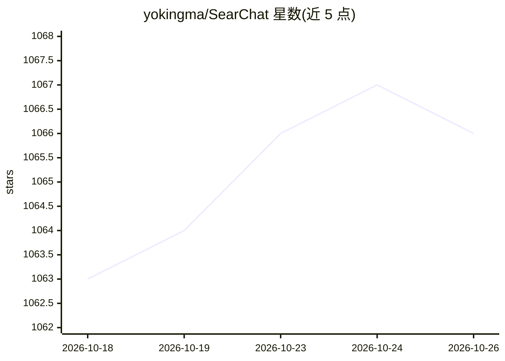

# yokingma/SearChat

⭐ 1,066 · TypeScript · MIT · 推送 2026-09-01 · [GitHub](https://github.com/yokingma/SearChat) · [官网](https://isou.chat) · 个人维护 · 中文 README

**AI 对话式搜索引擎：多模型接入，带 DeepResearch 报告生成**

基于 Turborepo 单仓架构的对话式搜索引擎，后端 Node.js + Koa，前端 Vue 3 + TypeScript。支持 OpenAI/Anthropic/Gemini/VertexAI 兼容 API（模型需支持 Tool Call），聚合 SearXNG、Bing、Google、Tavily 等七种搜索源。Deep Research 模式基于 LangChain + LangGraph 做迭代检索并生成带引用的结构化报告，该能力另以 deepsearcher npm 包独立提供。限制：MCP、图片搜索、文件解析为 TODO。对话历史缓存于浏览器本地。

## 筛选速览

| 维度 | 判定 | 备注 |
|---|---|---|
| AI 角色 | `ai-native` | 本体是模型或模型工具 |
| 许可风险 | `permissive` | MIT |
| 部署形态 | `self-host` | docker 或自建部署 |
| 模型依赖 | — | README 未给出锁定关系 |
| 硬件要求 | — | 无带数字的原话,不猜 |
| 安装摩擦 | `low` | 无编译、无系统依赖或容器化 |
| 成熟度 | — | 结构信号不足 |

## 能力要点

- Deep Research 模式：迭代检索并生成带引用格式的结构化报告
- 支持 OpenAI/Anthropic/Gemini/VertexAI 兼容 API，需模型支持 Tool Call
- 七种搜索源集成，SearXNG 免 API key 且内置于 Docker 部署
- Deep Research 能力以 deepsearcher npm 包独立供 Node.js 项目复用

## 适用场景

- 自部署一个带实时搜索的 AI 对话问答站点
- 对任意主题生成带引用来源的深度研究报告
- 在自有 Node.js 项目中集成 Deep Research 能力

## 场景标签

`聊天机器人` `RAG` · 领域:对话与助手

## 证据(README 行号)

> L3: **AI-powered conversational search engine**
> L21: - [x] 🤖 **Multi-model Support** - Compatible with OpenAI, Anthropic, Gemini APIs
> L33: - **Intelligent Research Mode** - Deep research functionality

## 星数曲线

2026-10-18 1,063 → 2026-10-26 1,066（+3）

---
*卡片 v1 · prompt 1.4 · 生成 2026-10-21 · 置信度 mid · 依据 README sha `bb564b7a83bb` · [字段定义](../../DATASET.md)*
