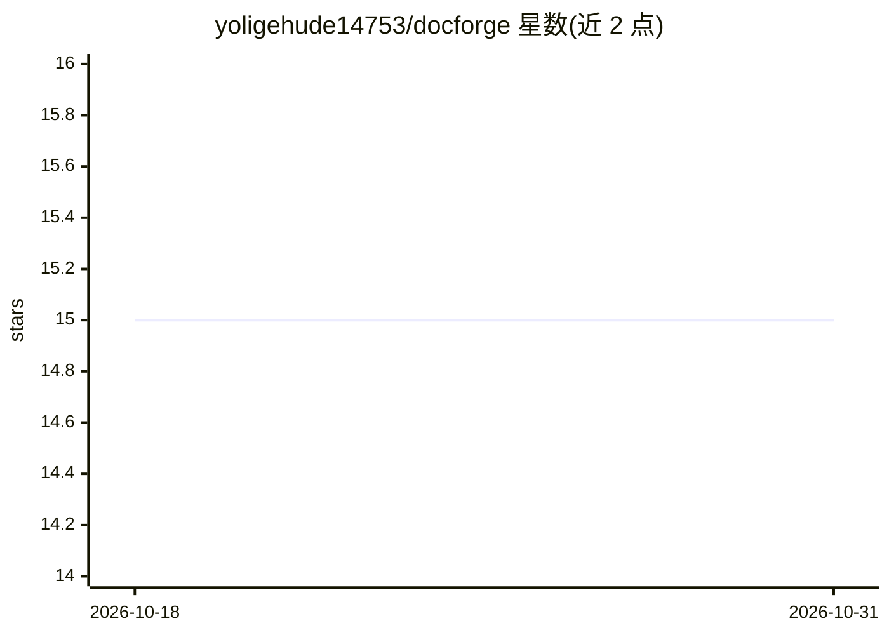

# yoligehude14753/docforge

⭐ 15 · TypeScript · MIT · 推送 2026-03-25 · [GitHub](https://github.com/yoligehude14753/docforge) · 个人维护 · 中文 README

**面向标书与方案撰写的 AI 文档生成桌面应用**

基于 Tauri（React 19 + TypeScript 前端、Rust 后端）的本地桌面应用：用户上传招标文件/需求说明与公司参考文档（PDF/Word），应用解析出结构化需求条目与大纲，从知识库检索相关段落（RAG），调用 AI 逐章节独立生成与重写，最终导出 .docx 文档。支持 OpenAI / DeepSeek / Claude / Ollama 多提供商切换，项目数据存储于本机，出站请求仅为用户配置的 AI API。三类平台提供安装包下载。

## 筛选速览

| 维度 | 判定 | 备注 |
|---|---|---|
| AI 角色 | `ai-native` | 本体是模型或模型工具 |
| 许可风险 | `permissive` | MIT |
| 部署形态 | `desktop` | 安装包/桌面程序 |
| 模型依赖 | local-ok | 支持本地模型 |
| 硬件要求 | — | 无带数字的原话,不猜 |
| 安装摩擦 | `low` | 无编译、无系统依赖或容器化 |
| 成熟度 | — | 结构信号不足 |

## 能力要点

- 需求文件解析为结构化条目并自动生成大纲
- 知识库驱动的 RAG 章节生成，基于用户上传资料
- 逐章节独立生成、重写与审阅，已审内容不被覆盖
- 多 AI 提供商切换（OpenAI / DeepSeek / Claude / Ollama），Ollama 无需 API Key

## 适用场景

- 针对招标文件逐项生成标书响应内容
- 基于公司历史方案与产品资料撰写解决方案或 Proposal
- 用本地 Ollama 模型离线生成文档内容

## 场景标签

`AI 写作` `文档解析` · 领域:内容生成

## 证据(README 行号)

> L5: 文档撰写最耗人的不是写作本身，而是通读需求、梳理逻辑、对照资料、反复调整结构这些前置工作。DocForge 把这部分接过来——上传你的需求文件和公司参考资料，它自动解析需求、生成大纲、调用 AI 逐章节起草内容，你只需要审阅和收尾。
> L30: ### 知识库驱动写作（RAG）

## 星数曲线

2026-10-18 15 → 2026-10-31 15（+0）

---
*卡片 v1 · prompt 1.4 · 生成 2026-10-30 · 置信度 mid · 依据 README sha `3b14a78cc5d2` · [字段定义](../../DATASET.md)*
