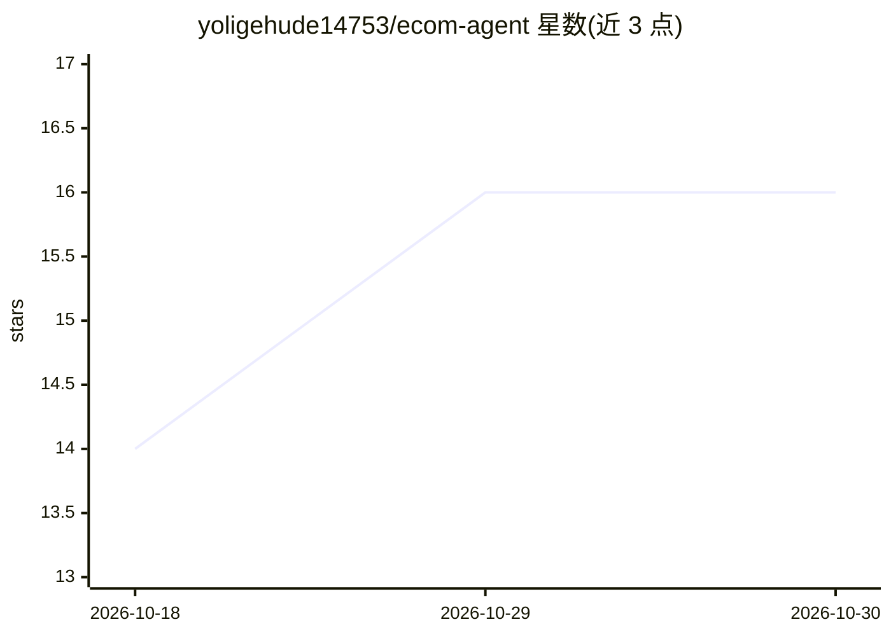

# yoligehude14753/ecom-agent

⭐ 16 · Python · MIT · 推送 2026-03-26 · [GitHub](https://github.com/yoligehude14753/ecom-agent) · 个人维护

**自托管亚马逊卖家 AI 自动化平台：选品、listing、评论、广告**

面向 Amazon FBA/FBM 卖家的自托管自动化平台（React + FastAPI，Docker Compose 部署），自带 LLM key 使用。五个模块：AI 选品研究（抓取 Best Sellers 并按竞争/利润/趋势三维打分）、Listing 生成（6 语言市场）、评论分析（LLM 抽取痛点与优化建议）、竞品监控（Celery Beat 每小时快照与告警）、广告优化（ACoS/ROAS 分析与竞价建议）。平台适配器可插拔以扩展新电商平台；Amazon SP-API 与广告 API 为可选配置项。

## 筛选速览

| 维度 | 判定 | 备注 |
|---|---|---|
| AI 角色 | `ai-native` | 本体是模型或模型工具 |
| 许可风险 | `permissive` | MIT |
| 部署形态 | `self-host` | docker 或自建部署 |
| 模型依赖 | local-ok | 支持本地模型 |
| 硬件要求 | — | 无带数字的原话,不猜 |
| 安装摩擦 | `low` | 无编译、无系统依赖或容器化 |
| 成熟度 | — | 结构信号不足 |

## 能力要点

- 选品研究抓取 10+ 类目 Best Sellers 并 LLM 三维打分
- Listing 生成覆盖 6 语言市场并校验字符限制
- 竞品监控每小时快照，支持降价/BSR/评论激增告警规则
- LLM 提供商可切换：OpenAI / Anthropic / Gemini / Ollama

## 适用场景

- 亚马逊卖家自助完成选品调研与 listing 撰写
- 分析竞品 ASIN 评论提取痛点与改进方向
- 跟踪竞品价格与 BSR 变化并接收告警

## 场景标签

`网页抓取` `AI 写作` `数据分析` · 领域:效率与自动化

## 证据(README 行号)

> L3: > **AI-powered e-commerce automation platform. Open-source, self-hosted, bring your own LLM key.**
> L10: EcomAgent automates the full Amazon FBA/FBM seller workflow — from product research to listing creation to competit
> L26: - LLM scoring on 3 dimensions: competition, profit potential, trend
> L106: LLM_PROVIDER=openai          # openai | anthropic | gemini | ollama

## 星数曲线

2026-10-18 14 → 2026-10-30 16（+2）

---
*卡片 v1 · prompt 1.4 · 生成 2026-10-30 · 置信度 high · 依据 README sha `6479d22ea82f` · [字段定义](../../DATASET.md)*
