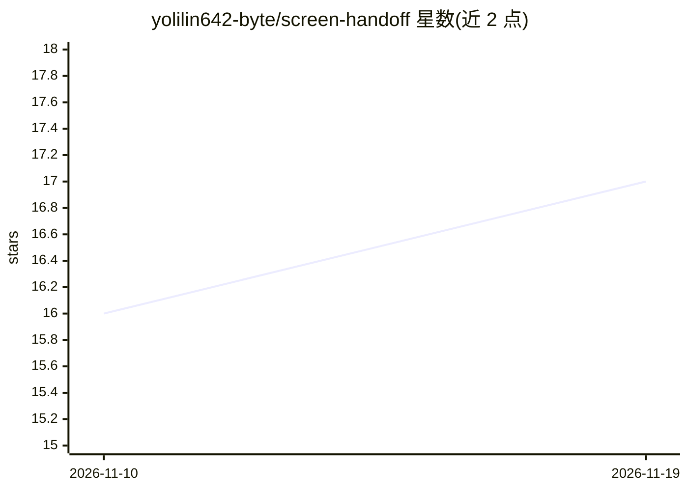

# yolilin642-byte/screen-handoff

⭐ 17 · JavaScript · LGPL-3.0 · 推送 2026-11-09 · [GitHub](https://github.com/yolilin642-byte/screen-handoff) · 个人维护 · 中文 README

**自托管方案：让 AI 操作你的电脑，手机实时旁观并随时接手**

基于 CrossDesk（LGPL-3.0）拼装的自托管 computer-use 方案：被控 Windows 电脑运行屏幕小程序，供 AI 截图、点鼠标、打字、操作已登录的 Chrome（OpenCLI）；画面经 WebRTC 推到手机网页或聊天应用的直播卡，人可按「我来」锁住 AI 操作接手。支持本地 Agent、VPS 上的 Agent、经 MCP 连接器接入的官端聊天应用（走通的只有 ChatGPT）与自建聊天页四种接入方式。需自行部署信令、反向代理等组件，多处以「没测过」标注未验证路径；Mac 版源码写了但未编译运行。

## 筛选速览

| 维度 | 判定 | 备注 |
|---|---|---|
| AI 角色 | `ai-ecosystem` | LLM/agent 周边工具 |
| 许可风险 | `viral` | LGPL-3.0 |
| 部署形态 | `None` |  |
| 模型依赖 | — | README 未给出锁定关系 |
| 硬件要求 | — | 无带数字的原话,不猜 |
| 安装摩擦 | `low` | 无编译、无系统依赖或容器化 |
| 成熟度 | `idea` | |

## 能力要点

- AI 经屏幕小程序截图、点鼠标、打字，经 OpenCLI 操作已登录的 Chrome
- 手机网页/聊天应用直播卡实时观看，「我来」按钮锁定 AI 接管
- 支持本地 Agent、VPS Agent、MCP 连接器、自建前后端四种接入方式
- 自托管：信令、门（反向代理）、TURN 中继等组件自行部署

## 适用场景

- 让 AI agent 在我的电脑上干活，我在手机上看并可随时接手
- 登录、验证码、付款等环节由人接管的人机协作流程
- 把电脑屏幕操作能力通过 MCP 连接器提供给 ChatGPT 等聊天应用里的 AI

## 场景标签

`GUI 自动化` · 领域:效率与自动化

## 证据(README 行号)

> L3: 你的 Windows 电脑上住一个小程序，AI 通过它截图、点鼠标、打字、开网页。你在手机上看实时画面，随时按「我来」接手，弄完按「还给你」。
> L20: |屏幕小程序|被控的电脑|AI 的手和眼：截图、点、打字、屏幕上的字幕、「我来」那把锁、每趟活的账|要。目前只有 Windows|
> L57: |**本地 Agent**：跑在这台电脑上、能执行命令的都算（Claude Code、Codex、Cursor、Gemini CLI……）|直接敲本机的屏幕小程序（127.0.0.1），网页走 OpenCLI；照 `skill/`

## 星数曲线

2026-11-10 16 → 2026-11-19 17（+1）

---
*卡片 v1 · prompt 1.4 · 生成 2026-11-18 · 置信度 high · 依据 README sha `915b13ef5668` · [字段定义](../../DATASET.md)*
