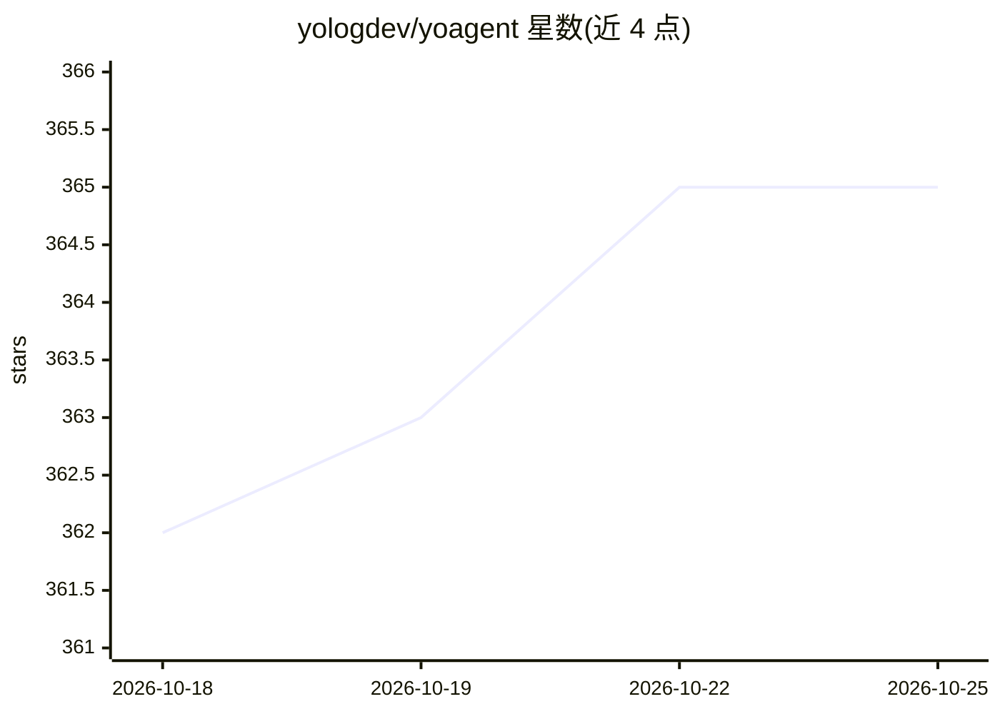

# yologdev/yoagent

⭐ 365 · Rust · MIT · 推送 2026-10-25 · [GitHub](https://github.com/yologdev/yoagent) · [官网](https://yologdev.github.io/yoagent/) · 组织维护 · 中文 README

**Rust agent 循环库：接入 7 种 LLM 协议，运行工具直至完成**

面向 Rust 开发者的 agent loop 库（crate），提供 prompt→LLM 流→工具调用（经策略门控）→完成检查的循环，支持 Anthropic Messages、OpenAI Completions/Responses、Azure、Gemini、Vertex、Bedrock 共 7 种原生协议。通过单一 Extension 插件契约扩展工具策略、输入检查、脱敏、预算与审计；支持会话树分支、子 agent、MCP（stdio/HTTP）、OpenAPI 工具、结构化输出与离线 MockProvider 测试。可编译到 wasm32 并运行于 Cloudflare Workers；不包含向量存储、嵌入或任务图编排层，明确将 RAG/编排类需求指向 rig、swiftide 等项目。MSRV 1.86。

## 筛选速览

| 维度 | 判定 | 备注 |
|---|---|---|
| AI 角色 | `ai-ecosystem` | LLM/agent 周边工具 |
| 许可风险 | `permissive` | MIT |
| 部署形态 | `None` |  |
| 模型依赖 | local-ok | 支持本地模型 |
| 硬件要求 | — | 无带数字的原话,不猜 |
| 安装摩擦 | `low` | 无编译、无系统依赖或容器化 |
| 成熟度 | — | 结构信号不足 |

## 能力要点

- 7 种原生 LLM 线协议实现，保留各 provider 特有特性
- 单一 Extension 契约覆盖工具策略、输入检查、脱敏、审计等环节
- 会话以树结构组织，支持分支、检查点与回放
- 同一代码可原生构建并编译到 wasm32 运行于 Cloudflare Workers

## 适用场景

- 在 Rust 项目中自建带工具调用的 agent 而不引入整套框架
- 为工具调用加策略门控、脱敏与审计日志
- 在 Cloudflare Workers 等边缘环境运行 agent loop
- 用 MockProvider 离线测试 agent 的中断与转向路径

## 场景标签

`Agent 框架` · 领域:Agent 开发

## 证据(README 行号)

> L12: **The agent loop for Rust.** Stream from any of 7 LLM protocols, run tools, loop until done.
> L14: A loop library, not an agent: it powers yoyo, a coding agent evolving its own source since March 2026, and runs fro
> L101: - **7 native wire protocols**, not one OpenAI-compat shim with adapters bolted on. Anthropic

## 星数曲线

2026-10-18 362 → 2026-10-25 365（+3）

---
*卡片 v1 · prompt 1.4 · 生成 2026-10-21 · 置信度 high · 依据 README sha `9adc3070274a` · [字段定义](../../DATASET.md)*
