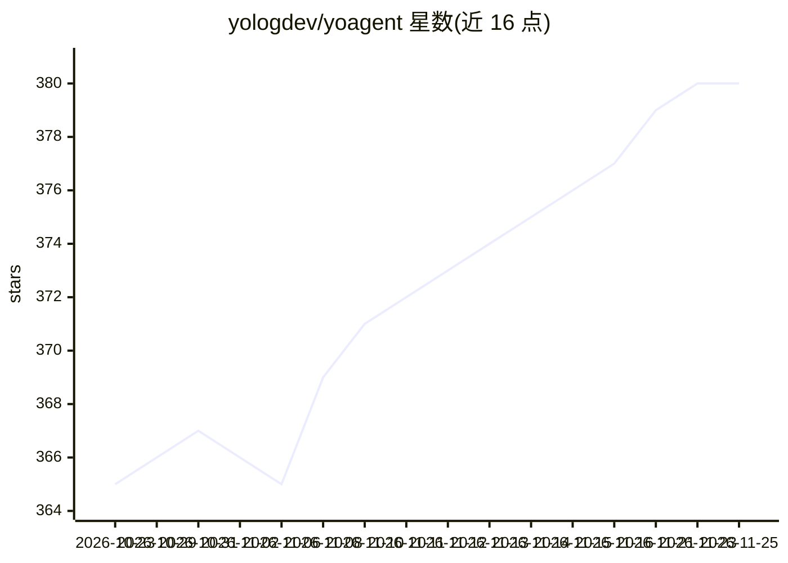

# yologdev/yoagent

⭐ 380 · Rust · MIT · 推送 2026-11-15 · [GitHub](https://github.com/yologdev/yoagent) · [官网](https://yologdev.github.io/yoagent/) · 组织维护 · 中文 README

**Rust 的 agent 循环库：接入 7 种 LLM 协议，运行工具循环至完成**

面向 Rust 开发者的 agent 循环库（crates.io 发布，版本 0.27）：提供事件流、工具调用门控、循环终止检查与执行限制；通过 Extension 插件契约支持输入检查、工具决策、结果脱敏与审计；会话历史为树状结构，支持分支、检查点与重放，运行可记录为 GASP 事件日志。原生支持 7 种线上协议（Anthropic Messages、OpenAI Completions/Responses、Azure、Gemini、Vertex、Bedrock），可编译为 wasm32 运行于 Cloudflare Worker。不含向量存储与 RAG 管线，相关需求被引导至 rig/swiftide 等其他库。

## 筛选速览

| 维度 | 判定 | 备注 |
|---|---|---|
| AI 角色 | `ai-ecosystem` | LLM/agent 周边工具 |
| 许可风险 | `permissive` | MIT |
| 部署形态 | `None` |  |
| 模型依赖 | local-ok | 支持本地模型 |
| 硬件要求 | — | 无带数字的原话,不猜 |
| 安装摩擦 | `low` | 无编译、无系统依赖或容器化 |
| 成熟度 | — | 结构信号不足 |

## 能力要点

- 7 种原生线上协议接入 20+ 提供商，而非单一 OpenAI 兼容层
- Extension 单一契约：工具门控、输入检查、脱敏、fail-closed 语义
- 会话历史为树状，支持 fork/checkpoint/seek 与中途转向
- MockProvider 离线脚本化多轮工具调用测试，无需网络与 key

## 适用场景

- 用 Rust 构建自托管的编码 agent 循环
- 需要工具调用策略门控与审计日志的 agent 应用
- 将 agent 编译为 wasm32 部署到 Cloudflare Worker

## 场景标签

`Agent 框架` · 领域:Agent 开发

## 证据(README 行号)

> L12: **The agent loop for Rust.** Stream from any LLM protocol, run tools and extensions, loop until done.
> L87: So it ships **no** vector stores, embedding pipelines, or task-graph layer — if your problem is
> L98: - **The loop is a free function.** `agent_loop()` is stateless and takes

## 星数曲线

2026-10-23 365 → 2026-11-25 380（+15）

---
*卡片 v1 · prompt 1.4 · 生成 2026-11-25 · 置信度 high · 依据 README sha `6d02191b57d1` · [字段定义](../../DATASET.md)*
