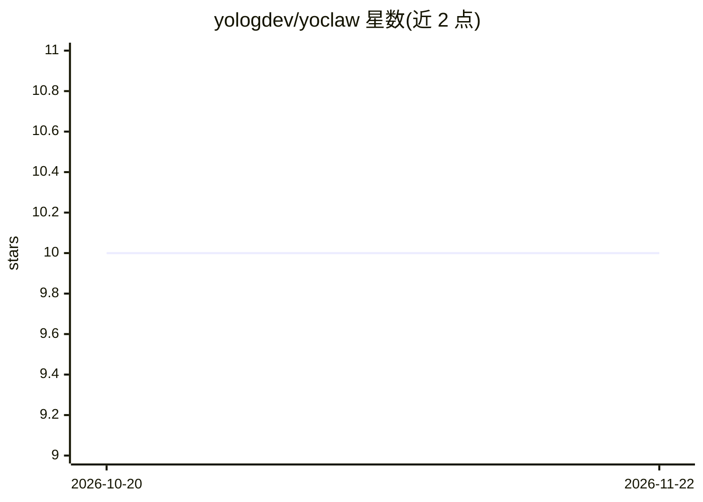

# yologdev/yoclaw

⭐ 10 · Rust · MIT · 推送 2026-02-27 · [GitHub](https://github.com/yologdev/yoclaw) · 个人维护

**单二进制 Rust AI agent：让 LLM 在消息平台上持久运行**

以 OpenClaw 的 Rust 重写为定位，将任意 LLM 变成消息平台上的持久化、可调用工具的 agent。核心机制包括：SQLite 单文件持久化（会话、消息队列、FTS5 长期记忆、审计日志）、崩溃恢复（消息先入队再处理）、安全策略（工具权限、shell 拒绝模式、路径/主机白名单）、按日/会话的 token 与轮次预算限制、markdown 技能文件扩展、以及按模型配置的子 agent 委派。无需 Docker 与 Redis，要求 Rust 1.75+ 编译构建，以 MIT 许可发布。

## 筛选速览

| 维度 | 判定 | 备注 |
|---|---|---|
| AI 角色 | `ai-ecosystem` | LLM/agent 周边工具 |
| 许可风险 | `permissive` | MIT |
| 部署形态 | `library` | 以包/库形式分发 |
| 模型依赖 | — | README 未给出锁定关系 |
| 硬件要求 | — | 无带数字的原话,不猜 |
| 安装摩擦 | `medium` | 含编译或系统依赖之一 |
| 成熟度 | — | 结构信号不足 |

## 能力要点

- 单个 Rust 二进制文件运行，无需 Docker/Redis 基础设施
- SQLite 单文件持久化：会话、队列、长期记忆（FTS5）与审计日志
- 安全策略：工具权限、shell 拒绝模式、路径/主机白名单
- markdown 技能文件扩展与多模型子 agent 委派

## 适用场景

- 在 Telegram 上运行一个能记住用户偏好与上下文的助手
- 需要崩溃后不丢消息的长时间运行 agent 服务
- 用技能文件为 agent 添加自定义能力

## 场景标签

`Agent 框架` `AI 助手` · 领域:Agent 开发

## 证据(README 行号)

> L18: **yoclaw** is a minimal, secure alternative to OpenClaw — a single Rust binary that turns any LLM into a persistent
> L20: No Docker. No Redis. No infrastructure. One binary, one config file.
> L97: - Rust 1.75+

## 星数曲线

2026-10-20 10 → 2026-11-22 10（+0）

---
*卡片 v1 · prompt 1.4 · 生成 2026-11-19 · 置信度 high · 依据 README sha `4520335e1689` · [字段定义](../../DATASET.md)*
