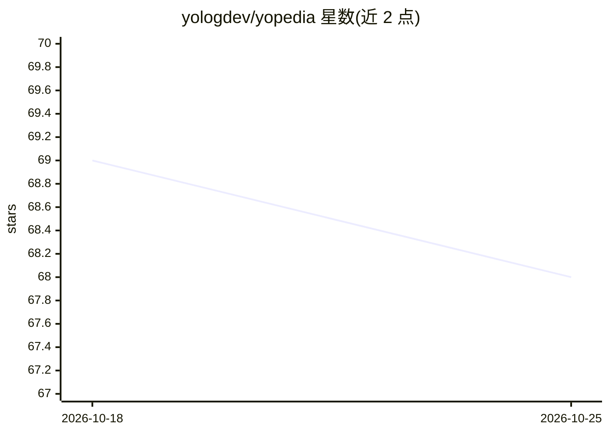

# yologdev/yopedia

⭐ 68 · TypeScript · 推送 2026-10-24 · [GitHub](https://github.com/yologdev/yopedia) · [官网](https://yologdev.github.io/yopedia/) · 个人维护

**人与 agent 共读共写的开源 wiki，由 agent 自主构建维护**

面向人与 AI agent 双读者的全栈 Next.js wiki：人类面为带 YAML frontmatter、wikilinks、引用与置信度标注的 Markdown 页面；agent 面为可持续累积的知识形态实验。由六个专职 agent（PM/Office Hour/Build/Review/Research/Architect）经 GitHub Issues 协作自主开发，代码零人写，失败自动回滚。功能含 ingest、query、lint、graph 视图、CLI、Docker。本地运行需配置一个 LLM provider key。

## 筛选速览

| 维度 | 判定 | 备注 |
|---|---|---|
| AI 角色 | `ai-native` | 本体是模型或模型工具 |
| 许可风险 | `none` | — |
| 部署形态 | `library` | 以包/库形式分发 |
| 模型依赖 | local-ok | 支持本地模型 |
| 硬件要求 | — | 无带数字的原话,不猜 |
| 安装摩擦 | `low` | 无编译、无系统依赖或容器化 |
| 成熟度 | — | 结构信号不足 |

## 能力要点

- 人与 agent 双面：Markdown+frontmatter 人类面与 agent 可消费形态
- 六个专职 agent 组成的自愈流水线，经 GitHub Issues 协作
- 60,000+ 行代码、2,000+ 测试由 agent 自主生成，失败自动回滚
- 支持 Anthropic/OpenAI/Google/Ollama 四种 provider 自动检测

## 适用场景

- 作为团队或多 agent 共享的带引用知识库
- 观察 agent 长期自主开发与维护项目的运行方式
- 搭建自托管的知识累积型 wiki（非 RAG 检索）

## 场景标签

`知识库管理` · 领域:知识与检索

## 证据(README 行号)

> L22: A wiki designed for both humans and agents to read and write.
> L60: **Now we take it to the next level.** Karpathy's single-agent LLM wiki becomes **yopedia** — a living commons built

## 星数曲线

2026-10-18 69 → 2026-10-25 68（-1）

---
*卡片 v1 · prompt 1.4 · 生成 2026-10-24 · 置信度 mid · 依据 README sha `7e255a9a45ac` · [字段定义](../../DATASET.md)*
