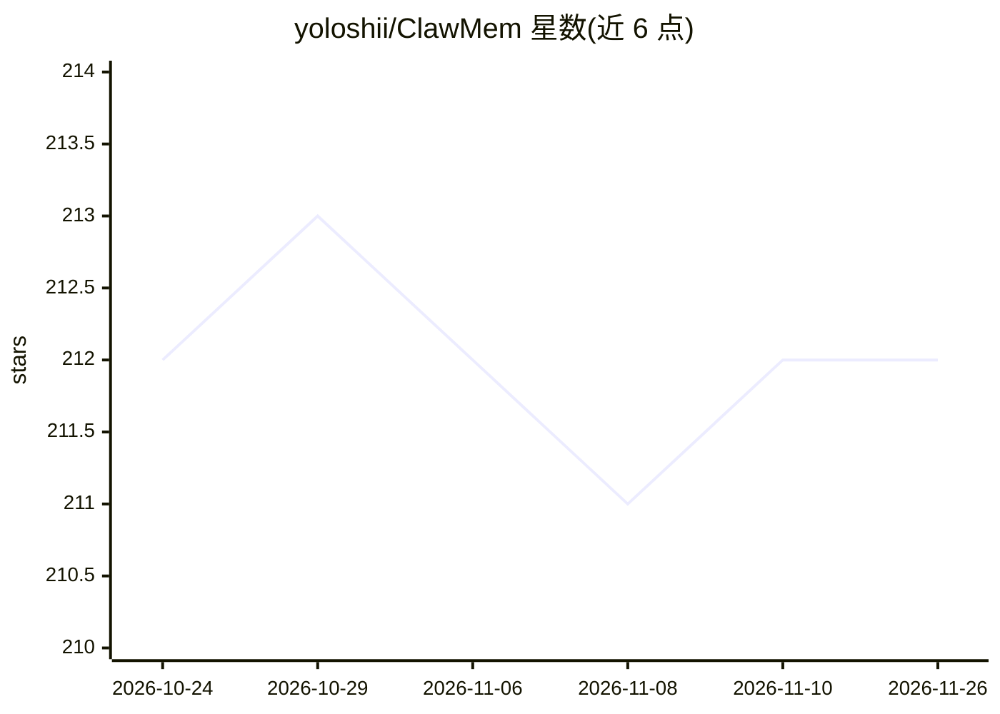

# yoloshii/ClawMem

⭐ 212 · TypeScript · MIT · 推送 2026-11-25 · [GitHub](https://github.com/yoloshii/ClawMem) · 个人维护

**给 AI 编码 Agent 提供本地持久记忆层：检索、钩子与 MCP 服务器**

运行在设备本地的 Agent 记忆层，将 markdown 笔记、项目文档与对话导出转为可检索的持久记忆。混合检索架构组合 BM25、向量搜索、倒数排序融合、查询扩展与 cross-encoder 重排，叠加时间衰减、置信度与共激活强化的复合评分，并做语义/时间/因果多图遍历与自演化记忆笔记。通过 Claude Code hooks、MCP 服务器、OpenClaw 插件或 Hermes MemoryProvider 接入，各路径写入同一本地 SQLite vault，无需 API key 与云服务。TypeScript on Bun，MIT 许可。

## 筛选速览

| 维度 | 判定 | 备注 |
|---|---|---|
| AI 角色 | `ai-ecosystem` | LLM/agent 周边工具 |
| 许可风险 | `permissive` | MIT |
| 部署形态 | `library` | 以包/库形式分发 |
| 模型依赖 | local-ok | 支持本地模型 |
| 硬件要求 | — | 无带数字的原话,不猜 |
| 安装摩擦 | `low` | 无编译、无系统依赖或容器化 |
| 成熟度 | — | 结构信号不足 |

## 能力要点

- 混合检索：BM25 + 向量 + 倒数排序融合 + cross-encoder 重排
- Claude Code hooks / MCP 服务器 / OpenClaw / Hermes 四种接入方式，共享同一本地 vault
- 从会话记录提取决策、偏好与里程碑，支持导入 ChatGPT/Claude.ai/Slack 对话导出
- 完全本地运行，无 API key、无云依赖

## 适用场景

- 让编码 Agent 跨会话记住项目决策与偏好
- 把散落的笔记和对话记录变成可检索的 Agent 记忆
- 多个 Agent 工具（Claude Code/OpenClaw/Hermes）共享同一份项目记忆
- 离线/私有环境下构建 Agent 记忆系统

## 场景标签

`Agent 记忆` `编码 Agent` `RAG` · 领域:Agent 开发

## 证据(README 行号)

> L5: **On-device memory for Claude Code, OpenClaw, Hermes, and AI agents.** Retrieval-augmented search, hooks, and an MCP
> L9: Integrates via Claude Code hooks, an MCP server (works with any MCP-compatible client), a native OpenClaw plugin, or
> L52: Runs fully local with no API keys and no cloud services. Integrates via Claude Code hooks and MCP tools, as a nativ

## 星数曲线

2026-10-24 212 → 2026-11-26 212（+0）

---
*卡片 v1 · prompt 1.4 · 生成 2026-11-25 · 置信度 high · 依据 README sha `a0d2561d0d7c` · [字段定义](../../DATASET.md)*
