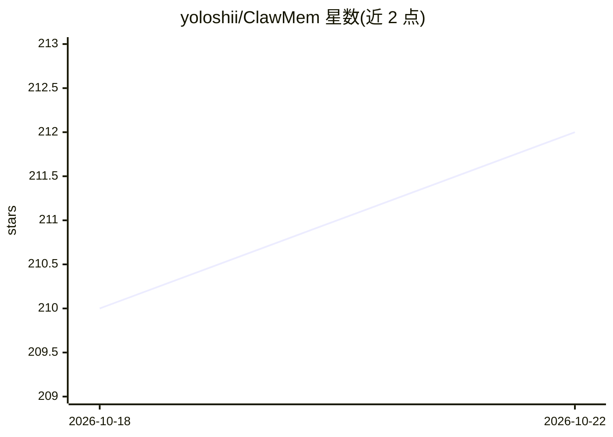

# yoloshii/ClawMem

⭐ 212 · TypeScript · MIT · 推送 2026-10-20 · [GitHub](https://github.com/yoloshii/ClawMem) · 个人维护

**给 AI 编码 agent 的本地持久记忆层：检索增强 + hooks + MCP**

面向 Claude Code、OpenClaw、Hermes 及任意 MCP 兼容客户端的本地记忆系统：将 markdown 笔记、项目文档和会话记录转为 SQLite 知识库，通过 BM25 + 向量检索 + 倒数排名融合 + 重排的混合检索浮现上下文，用本地 GGUF 观察模型从会话提取决策/偏好，支持跨运行时共享同一 vault、矛盾检测、因果图遍历与生命周期管理。TypeScript on Bun，MIT 许可，无需 API key 与云服务。Windows 原生不推荐，需用 WSL2。

## 筛选速览

| 维度 | 判定 | 备注 |
|---|---|---|
| AI 角色 | `ai-ecosystem` | LLM/agent 周边工具 |
| 许可风险 | `permissive` | MIT |
| 部署形态 | `library` | 以包/库形式分发 |
| 模型依赖 | local-ok | 支持本地模型 |
| 硬件要求 | — | 无带数字的原话,不猜 |
| 安装摩擦 | `low` | 无编译、无系统依赖或容器化 |
| 成熟度 | — | 结构信号不足 |

## 能力要点

- 混合检索：BM25 + 向量 + RRF + 查询扩展 + cross-encoder 重排
- 本地 GGUF 观察模型从会话提取决策/偏好/里程碑，无需云服务
- Claude Code hooks / MCP server / OpenClaw 插件 / Hermes MemoryProvider 四种接入方式共享同一 SQLite vault
- 矛盾检测、跨实体合并防护与提示注入防护

## 适用场景

- 让 Claude Code 等 AI 编码 agent 记住我跨会话的决策与偏好
- 把 markdown 笔记与研究资料变成 agent 可检索的持久记忆
- 多个 agent 运行时共享同一项目的记忆库

## 场景标签

 · 领域:AI agent 基础设施/记忆层

## 证据(README 行号)

> L5: **On-device memory for Claude Code, OpenClaw, Hermes, and AI agents.** Retrieval-augmented search, hooks, and an MCP
> L9: Integrates via Claude Code hooks, an MCP server (works with any MCP-compatible client), a native OpenClaw plugin, or
> L52: Runs fully local with no API keys and no cloud services. Integrates via Claude Code hooks and MCP tools, as a nativ

## 星数曲线

2026-10-18 210 → 2026-10-22 212（+2）

---
*卡片 v1 · prompt 1.4 · 生成 2026-10-22 · 置信度 high · 依据 README sha `bd4158eece7a` · [字段定义](../../DATASET.md)*
