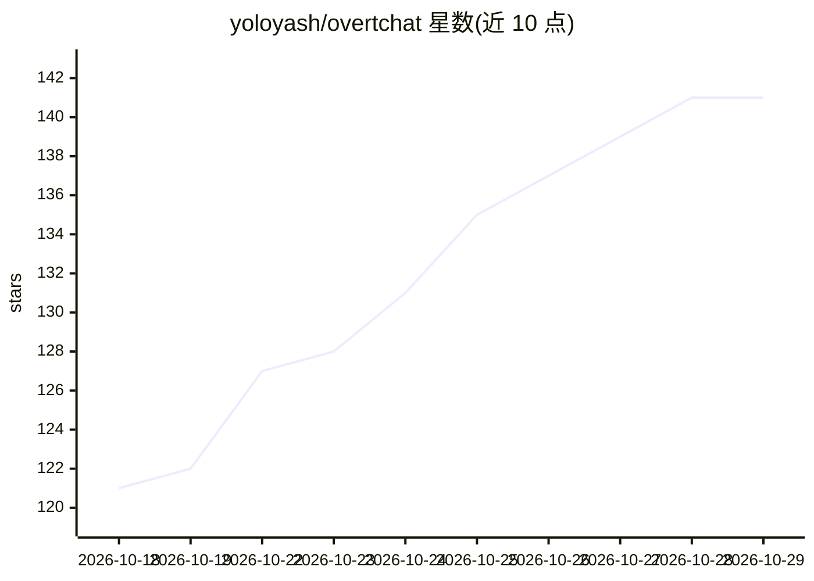

# yoloyash/overtchat

⭐ 141 · TypeScript · MIT · 推送 2026-10-28 · [GitHub](https://github.com/yoloyash/overtchat) · [官网](https://overtchat.com) · 个人维护

**自托管的本地 AI 聊天界面，支持网页/移动端**

自托管的多端 AI 聊天应用：通过引导式安装脚本部署服务端（Linux/macOS），连接 vLLM、llama.cpp、SGLang 等已有推理服务器或托管提供商，提供网页、macOS/Windows/Linux 桌面端与原生 Android/iOS 客户端。内置可选的 SearXNG 搜索、Kokoro TTS、Parakeet STT，无需提供商 API key 即可使用本地模型；支持带免费回退的联网搜索、浏览器内双向语音对话、家庭多账号共享本地模型，并可接入 Codex、Claude Code 等 coding agent 会话。MIT 许可。桌面应用仅连接服务器、不自带服务端。

## 筛选速览

| 维度 | 判定 | 备注 |
|---|---|---|
| AI 角色 | `ai-native` | 本体是模型或模型工具 |
| 许可风险 | `permissive` | MIT |
| 部署形态 | `None` |  |
| 模型依赖 | local-ok | 支持本地模型 |
| 硬件要求 | — | 无带数字的原话,不猜 |
| 安装摩擦 | `low` | 无编译、无系统依赖或容器化 |
| 成熟度 | — | 结构信号不足 |

## 能力要点

- 对接 vLLM/llama.cpp/SGLang 等推理服务器及托管提供商
- 安装器内置 SearXNG 搜索、Kokoro TTS、Parakeet STT，零 API key 起步
- 网页 + 桌面 + 原生 Android/iOS 客户端，家庭多账号共享本地模型
- 浏览器内双向语音对话与带来源引用的多级回退联网搜索

## 适用场景

- 在家里服务器上自托管 AI 聊天，全家人各自账号共享本地模型
- 用手机 App 连接自己的服务器，同步聊天、项目与文件
- 本地模型配合本地语音与搜索服务，不依赖付费 API
- 在统一界面中跟进 Codex/Claude Code 等 coding agent 会话

## 场景标签

`聊天机器人` · 领域:对话与助手

## 证据(README 行号)

> L18: OvertChat is a self-hosted home for everyday AI. Connect **vLLM, llama.cpp,
> L19: or SGLang**, bring a hosted provider when you want one, and get straight to
> L102: Use the responsive web app or connect the **native Android and iOS apps** to

## 星数曲线

2026-10-18 121 → 2026-10-29 141（+20）

---
*卡片 v1 · prompt 1.4 · 生成 2026-10-23 · 置信度 high · 依据 README sha `64ac02ab7e89` · [字段定义](../../DATASET.md)*
