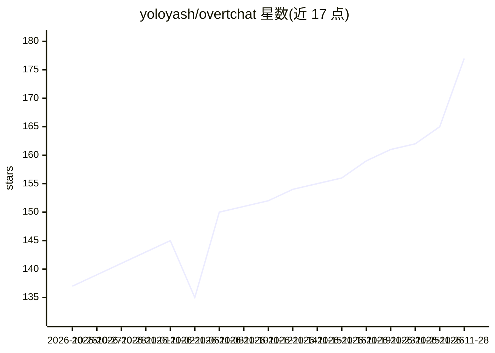

# yoloyash/overtchat

⭐ 177 · TypeScript · MIT · 推送 2026-11-27 · [GitHub](https://github.com/yoloyash/overtchat) · [官网](https://overtchat.com) · 个人维护

**自托管多端 LLM 聊天应用：接本地模型、语音与编码代理**

OvertChat 是一个自托管的聊天应用，用于接入用户已在运行的模型服务器：Ollama、vLLM、llama.cpp、SGLang、LM Studio 或任意 OpenAI 兼容端点，也可添加托管服务商。内置语音识别与合成（Parakeet/Kokoro，无需 API key）、网页搜索、Python 代码沙箱，并可通过 Host Connector 在本地或 SSH 主机上运行编码代理会话。提供 Web、桌面（macOS/Windows/Linux）与 Android/iOS 客户端，账户、聊天与文件存于单个 SQLite 数据库。面向希望在自己服务器上运行模型并多端访问的个人或家庭用户。

## 筛选速览

| 维度 | 判定 | 备注 |
|---|---|---|
| AI 角色 | `ai-ecosystem` | LLM/agent 周边工具 |
| 许可风险 | `permissive` | MIT |
| 部署形态 | `None` |  |
| 模型依赖 | local-ok | 支持本地模型 |
| 硬件要求 | `cpu-ok` | |
| 安装摩擦 | `low` | 无编译、无系统依赖或容器化 |
| 成熟度 | — | 结构信号不足 |

## 能力要点

- 接入 Ollama/vLLM/llama.cpp/SGLang/LM Studio 等本地模型服务器与 OpenAI 兼容端点
- 内置 Parakeet 语音识别与 Kokoro 语音合成的实时语音对话，无需 API key，CPU 可运行
- 通过 Host Connector 从任意客户端（含手机）运行 Codex、Claude Code 等 6 种编码代理
- Web、macOS、Windows、Linux、Android、iOS 六端客户端对应同一服务器，数据存于单个 SQLite 文件

## 适用场景

- 在家庭服务器上部署本地大模型并供全家多设备使用
- 用手机远程查看和操作工作站上的编码代理会话
- 需要语音对话、网页搜索与代码执行且不依赖托管 API 的自托管聊天环境

## 场景标签

`聊天机器人` `语音 Agent` `编码 Agent` · 领域:编码与开发

## 证据(README 行号)

> L21: OvertChat is a self-hosted chat app for the models you already run. Point it
> L26: run on your own machines. Accounts, chats, and files live in one SQLite file
> L121: and credentials already on that host. OvertChat is the front end: start or

## 星数曲线

2026-10-26 137 → 2026-11-28 177（+40）

---
*卡片 v1 · prompt 1.4 · 生成 2026-11-27 · 置信度 high · 依据 README sha `93a511e064ea` · [字段定义](../../DATASET.md)*
