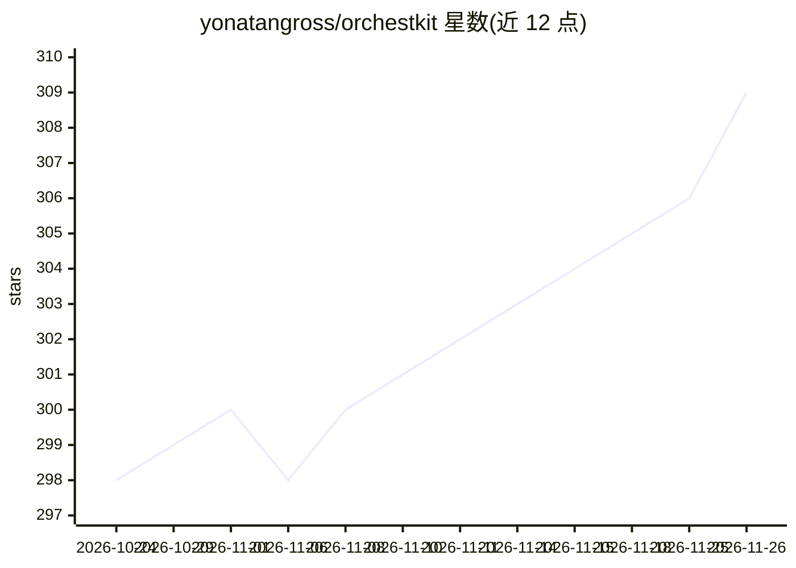

# yonatangross/orchestkit

⭐ 309 · TypeScript · MIT · 推送 2026-11-25 · [GitHub](https://github.com/yonatangross/orchestkit) · [官网](https://orchestkit.dev) · 个人维护

**为 Claude Code 等编码代理提供技能、子代理与钩子的插件集**

开源（MIT）插件集合，包含 115 个 skills、36 个 agents、163 个 hooks，装入 Claude Code、Cursor、Codex、Devin 等编码代理宿主，用于开发流程中的代码评审、测试、安全检查与跨会话记忆。核心机制：按宿主矩阵分发不同能力子集（Claude Code 获得完整插件，Codex 仅 9 个 skills），hooks 注册到 32 个生命周期事件实现质量门禁，事件与遥测写入本地文件，远程同步默认关闭。运行前提是宿主工具本身（如 Claude Code 2.1.327+），Context7 MCP 服务器为 22 个 agents 的前置依赖。

## 筛选速览

| 维度 | 判定 | 备注 |
|---|---|---|
| AI 角色 | `ai-ecosystem` | LLM/agent 周边工具 |
| 许可风险 | `permissive` | MIT |
| 部署形态 | `library` | 以包/库形式分发 |
| 模型依赖 | — | README 未给出锁定关系 |
| 硬件要求 | — | 无带数字的原话,不猜 |
| 安装摩擦 | `low` | 无编译、无系统依赖或容器化 |
| 成熟度 | — | 结构信号不足 |

## 能力要点

- 115 skills + 36 agents + 163 hooks，经同一 marketplace 分发，核心或k-extras 按需加载
- 8 个编码代理宿主支持矩阵，附实测日期与证据文档
- 163 个 hooks 覆盖 32 个生命周期事件：密钥写入阻断、git 保护、质量门禁
- 遥测与生命周期事件仅写本地文件，远程同步默认关闭且需自行配置

## 适用场景

- 让 Claude Code 会话保留团队技术栈与代码规范知识，避免每次重复说明
- 在提交前通过 hooks 自动执行测试、分支保护与敏感信息检查
- 在多个编码代理宿主间复用同一套技能与工作流配置

## 场景标签

`Agent 框架` `编码 Agent` `代码审查` `工作流自动化` · 领域:Agent 开发

## 证据(README 行号)

> L17: OrchestKit is free and open source (MIT, no account): skills and agents for Claude Code, Cursor, Codex and five mor
> L107: |** 115 Skills**|82 in core `ork` (workflows, FastAPI, React 19, testing, security, database design) and 33 opt-in
> L170: OrchestKit is a quality-gate plugin, so its hooks are the product rather than an

## 星数曲线

2026-10-24 298 → 2026-11-26 309（+11）

---
*卡片 v1 · prompt 1.4 · 生成 2026-11-25 · 置信度 high · 依据 README sha `65dfc23b113b` · [字段定义](../../DATASET.md)*
