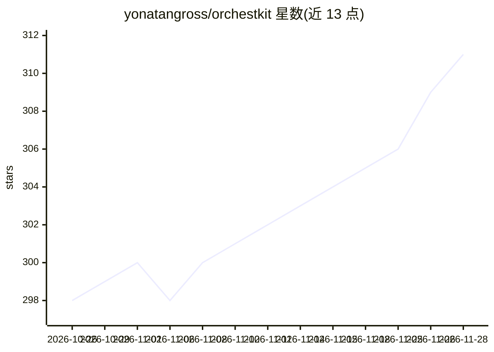

# yonatangross/orchestkit

⭐ 311 · TypeScript · MIT · 推送 2026-11-27 · [GitHub](https://github.com/yonatangross/orchestkit) · [官网](https://orchestkit.dev) · 个人维护

**给 Claude Code 等编码 agent 提供技能、agent 与钩子的插件集**

OrchestKit 是一个 MIT 许可、无需账号的开源插件集合，面向 Claude Code、Cursor、Codex 等多个编码 agent 宿主，提供 115 个技能（工作流、FastAPI、React、测试、安全、数据库设计及 RAG、LangGraph、MCP 参考技能）、36 个专用 agent 与 163 个钩子（预提交检查、git 保护、质量门、浏览器安全）。通过插件市场或 npx 安装；钩子写入本地事件与遥测日志，默认无远程同步，网络访问默认关闭。Claude Code 支持完整功能，其他宿主按支持矩阵各有差异。

## 筛选速览

| 维度 | 判定 | 备注 |
|---|---|---|
| AI 角色 | `ai-ecosystem` | LLM/agent 周边工具 |
| 许可风险 | `permissive` | MIT |
| 部署形态 | `library` | 以包/库形式分发 |
| 模型依赖 | — | README 未给出锁定关系 |
| 硬件要求 | — | 无带数字的原话,不猜 |
| 安装摩擦 | `low` | 无编译、无系统依赖或容器化 |
| 成熟度 | — | 结构信号不足 |

## 能力要点

- 115 个技能按需加载，33 个为可选 ork-extras 参考技能
- 163 个钩子覆盖 32 个生命周期事件，含密钥写入阻断与 git 保护
- 支持 8 个宿主（Claude Code/Cursor/Codex/Devin 等），附实测支持矩阵
- 遥测默认仅写本地文件，无远程端点，逐项提供关闭开关

## 适用场景

- 为 Claude Code 会话注入项目栈与生产模式的持久知识
- 在提交前自动执行测试、密钥检查与分支保护
- 在 Cursor/Codex/Devin 等宿主中复用同一套技能库

## 场景标签

`编码 Agent` · 领域:编码与开发

## 证据(README 行号)

> L17: OrchestKit is free and open source (MIT, no account): skills and agents for Claude Code, Cursor, Codex and five mor
> L107: |** 115 Skills**|82 in core `ork` (workflows, FastAPI, React 19, testing, security, database design) and 33 opt-in
> L109: |** 163 Hooks**|Pre-commit checks, git protection, quality gates, browser safety — ship with confidence|

## 星数曲线

2026-10-26 298 → 2026-11-28 311（+13）

---
*卡片 v1 · prompt 1.4 · 生成 2026-11-28 · 置信度 high · 依据 README sha `5add0bd2a413` · [字段定义](../../DATASET.md)*
