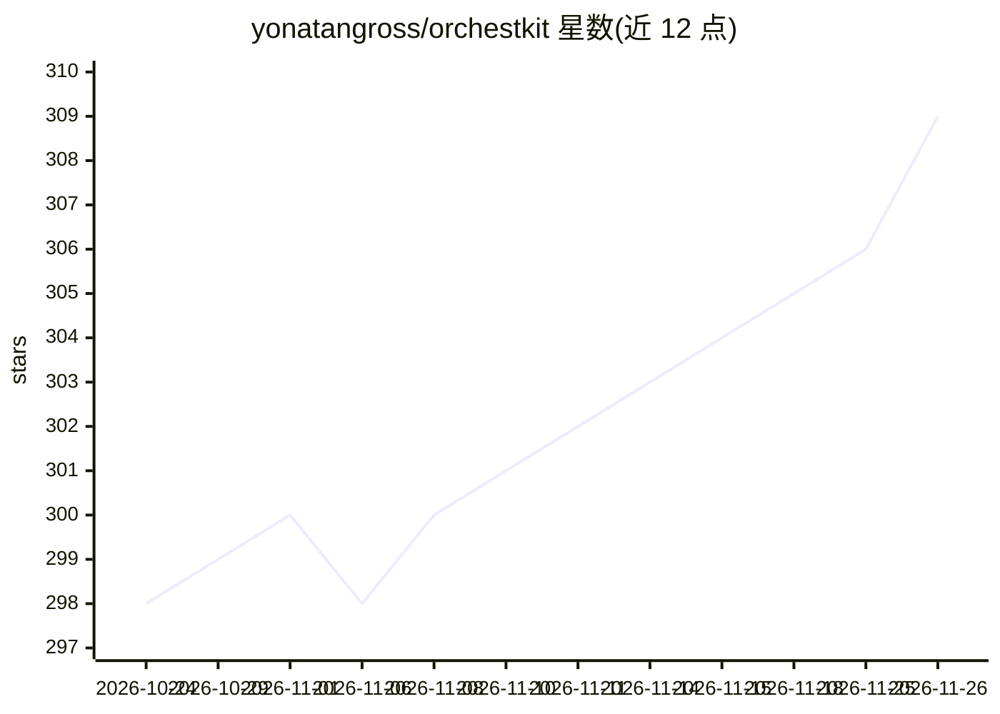

# yonatangross/orchestkit

⭐ 309 · TypeScript · MIT · 推送 2026-11-25 · [GitHub](https://github.com/yonatangross/orchestkit) · [官网](https://orchestkit.dev) · 个人维护

**为 Claude Code 等编码 agent 提供技能、子代理与钩子的插件包**

开源（MIT）的编码 agent 技能插件集：115 个技能、36 个专用子代理（如 backend-architect、security-auditor）、163 个钩子，覆盖工作流、测试、安全、数据库设计等主题。核心机制是通过宿主插件市场安装后，为编码会话注入持久化生产模式知识、按需加载技能，并用生命周期钩子在本地执行提交检查、git 保护、质量门禁与状态记录。支持 Claude Code、Cursor、Codex、Devin 等多个宿主，各宿主能力按实测矩阵分列。数据默认只写本地文件，无内建远程端点。

## 筛选速览

| 维度 | 判定 | 备注 |
|---|---|---|
| AI 角色 | `ai-ecosystem` | LLM/agent 周边工具 |
| 许可风险 | `permissive` | MIT |
| 部署形态 | `library` | 以包/库形式分发 |
| 模型依赖 | locked-api |  |
| 硬件要求 | — | 无带数字的原话,不猜 |
| 安装摩擦 | `low` | 无编译、无系统依赖或容器化 |
| 成熟度 | — | 结构信号不足 |

## 能力要点

- 115 个按需加载技能 + 33 个可选参考技能（RAG、LangGraph、MCP 等）
- 163 个跨 32 个生命周期事件的钩子：密钥写入阻断、git 安全、质量门禁
- 支持 8 个宿主（Claude Code/Cursor/Codex/Devin 等），附实测能力矩阵
- 观测数据默认仅写本地 JSONL，远程同步需用户自行配置端点

## 适用场景

- 为 Claude Code 会话注入团队技术栈与编码规范知识
- 用钩子自动执行提交前测试与安全检查
- 在 Cursor/Codex/Devin 等宿主间复用同一套技能
- 用 setup 向导扫描仓库并推荐技能与 MCP 配置

## 场景标签

`编码 Agent` · 领域:编码与开发

## 证据(README 行号)

> L17: OrchestKit is free and open source (MIT, no account): skills and agents for Claude Code, Cursor, Codex and five mor
> L107: |** 115 Skills**|82 in core `ork` (workflows, FastAPI, React 19, testing, security, database design) and 33 opt-in

## 星数曲线

2026-10-24 298 → 2026-11-26 309（+11）

---
*卡片 v1 · prompt 1.4 · 生成 2026-11-26 · 置信度 high · 依据 README sha `3337d1804fc0` · [字段定义](../../DATASET.md)*
