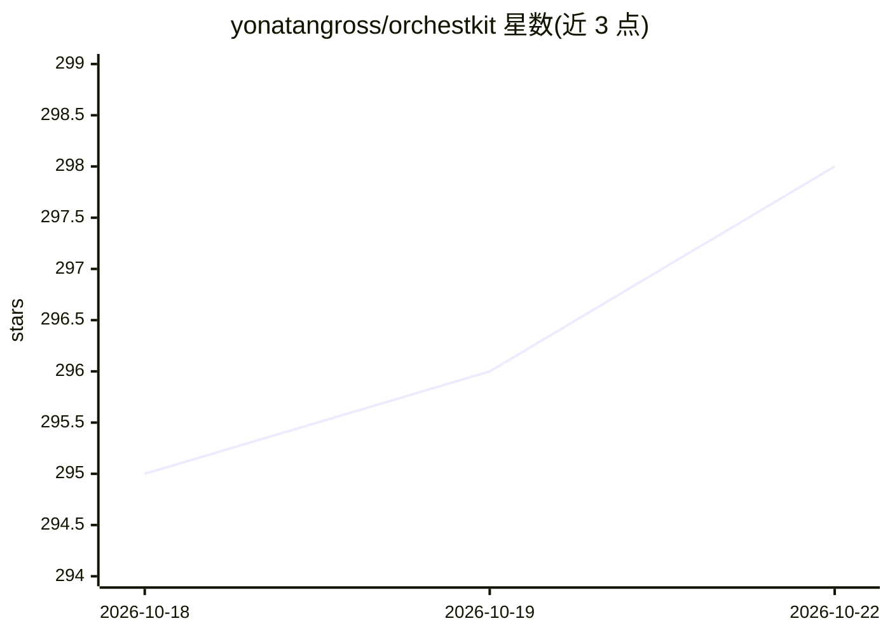

# yonatangross/orchestkit

⭐ 298 · TypeScript · MIT · 推送 2026-10-21 · [GitHub](https://github.com/yonatangross/orchestkit) · [官网](https://orchestkit.dev) · 个人维护

**Claude Code 开发插件：110 技能、36 agents、162 hooks 的开发工具包**

面向 Claude Code 用户的插件，提供按需加载的 110 个 skills（RAG、FastAPI、React 19、测试、安全、数据库设计等）、36 个专家 persona agents 与 162 个覆盖 32 个生命周期事件的 hooks（pre-commit 检查、git 保护、质量门禁、浏览器安全）。通过 /ork:setup 向导检测技术栈并写入 MCP 配置；Context7 MCP 为 22 个 agent 的前置条件但需用户自行添加。hooks 数据只写本地 JSONL 文件，网络上报默认关闭且需显式配置。支持 Cursor、Codex、pi 等宿主（功能矩阵见 README）。

## 筛选速览

| 维度 | 判定 | 备注 |
|---|---|---|
| AI 角色 | `ai-ecosystem` | LLM/agent 周边工具 |
| 许可风险 | `permissive` | MIT |
| 部署形态 | `library` | 以包/库形式分发 |
| 模型依赖 | — | README 未给出锁定关系 |
| 硬件要求 | — | 无带数字的原话,不猜 |
| 安装摩擦 | `low` | 无编译、无系统依赖或容器化 |
| 成熟度 | — | 结构信号不足 |

## 能力要点

- 110 个按需加载的 skills 覆盖 RAG/FastAPI/React 19/测试/安全等场景
- 36 个专家 persona agents 负责任务路由（backend-architect、security-auditor 等）
- 162 个 hooks 做 pre-commit 检查、git 保护与质量门禁
- hooks 观测数据仅写本地文件，远程同步默认关闭，网络访问需显式 opt-in

## 适用场景

- 给 Claude Code 会话注入项目模式与质量门禁，避免每次重复解释技术栈
- 通过 /ork:auto 描述目标自动路由到合适技能
- 用 hooks 拦截坏提交、保护分支并在提交前跑测试

## 场景标签

 · 领域:开发者工具/AI 编程

## 证据(README 行号)

> L17: OrchestKit is a free, open source Claude Code plugin: skills, agents and hooks for review, testing, security and me
> L93: |** 110 Skills**|RAG patterns, FastAPI, React 19, testing, security, database design, ML integration — loaded on-de

## 星数曲线

2026-10-18 295 → 2026-10-22 298（+3）

---
*卡片 v1 · prompt 1.4 · 生成 2026-10-21 · 置信度 high · 依据 README sha `52475393049e` · [字段定义](../../DATASET.md)*
