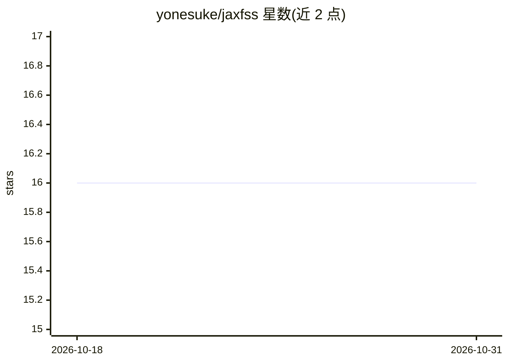

# yonesuke/jaxfss

⭐ 16 · Python · MIT · 推送 2026-09-19 · [GitHub](https://github.com/yonesuke/jaxfss) · [官网](https://yonesuke.github.io/jaxfss/) · 个人维护

**用神经网络做临界现象有限尺寸缩放分析的 JAX/Flax 库**

基于 Flax NNX、JAX 与 Optax 实现的 Neural Scaling Analysis（NSA）库：在连续相变附近，同时估计临界参数（临界温度与两个临界指数）及未知的普适缩放函数 F。内置可训练的 Rational 激活 MLP 表示缩放函数，物理临界指数与网络权重使用多优化器分别设定学习率，计算复杂度对数据点数呈线性，支持 CPU/GPU/TPU 上的 JIT 加速训练。以 Python 包形式通过 pip/uv 安装，面向凝聚态与统计物理研究者，配有文档与教程，相关论文发表于 Physical Review E。

## 筛选速览

| 维度 | 判定 | 备注 |
|---|---|---|
| AI 角色 | `ai-native` | 本体是模型或模型工具 |
| 许可风险 | `permissive` | MIT |
| 部署形态 | `library` | 以包/库形式分发 |
| 模型依赖 | — | README 未给出锁定关系 |
| 硬件要求 | — | 无带数字的原话,不猜 |
| 安装摩擦 | `low` | 无编译、无系统依赖或容器化 |
| 成熟度 | — | 结构信号不足 |

## 能力要点

- 同时估计临界温度、临界指数与普适缩放函数
- RationalMLP 内置有理激活，无外部依赖表示物理函数
- 临界指数与网络权重分离学习率的多优化器训练
- JAX JIT 加速，支持 CPU/GPU/TPU

## 适用场景

- 从 Monte Carlo 模拟数据拟合相变的临界指数与临界点
- 提取并可视化普适缩放函数
- 大规模有限尺寸数据集的缩放分析

## 场景标签

`科研工具` · 领域:学习与行业

## 证据(README 行号)

> L10: **Flax NNX implementation of Neural Scaling Analysis (NSA) for Finite-Size Scaling**
> L22: `jaxfss` estimates critical parameters $(T_{\mathrm{c}}, c_1, c_2)$ and the scaling function $F$ simultaneously usi

## 星数曲线

2026-10-18 16 → 2026-10-31 16（+0）

---
*卡片 v1 · prompt 1.4 · 生成 2026-10-30 · 置信度 high · 依据 README sha `c0987c68c5c8` · [字段定义](../../DATASET.md)*
