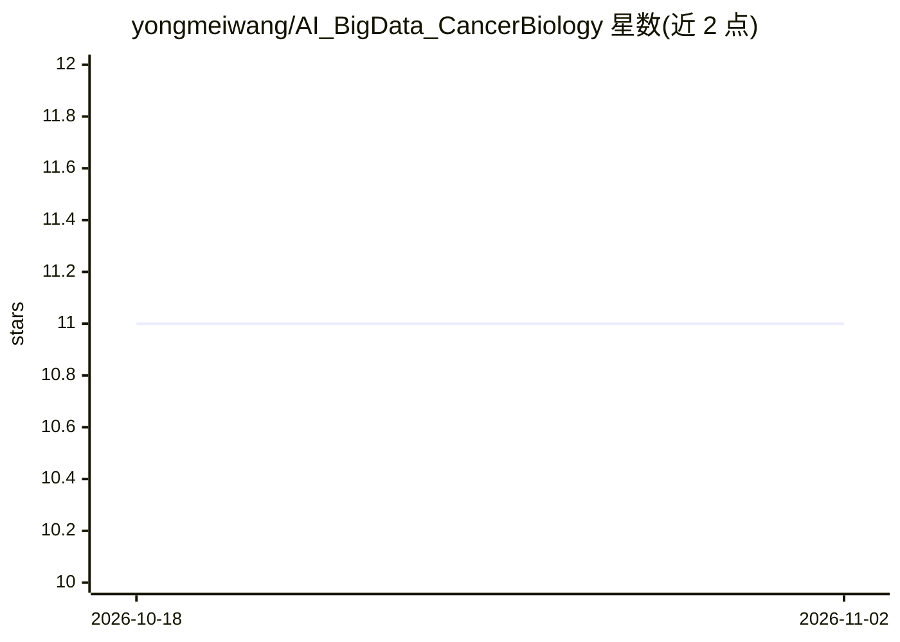

# yongmeiwang/AI_BigData_CancerBiology

⭐ 11 · Jupyter Notebook · NOASSERTION · 推送 2026-10-21 · [GitHub](https://github.com/yongmeiwang/AI_BigData_CancerBiology) · 组织维护

**面向本科与高中生的癌症生物学 AI 与大数据课程材料**

University of Memphis 的教学课程仓库，讲授癌症生物学中的大数据概念与 AI 数据驱动分析，覆盖基因组学、转录组学、机器学习与网络分析。内容含 7 讲 PDF 讲义、6 个渐进式 Jupyter notebook 练习（GTEx 基因表达分析、逻辑回归分类、TCGA BRCA 突变频率、Kaplan–Meier 生存分析等）及公开数据集衍生教学数据（GTEx/TCGA/CCLE）。不要求编程基础，通过 GitHub 浏览、下载文件或 ZIP 归档获取，并经 GitHub Pages 提供渲染示例、Zenodo 提供 DOI。

## 筛选速览

| 维度 | 判定 | 备注 |
|---|---|---|
| AI 角色 | `ai-knowledge` | 知识聚合/清单类 |
| 许可风险 | `none` | NOASSERTION |
| 部署形态 | `None` |  |
| 模型依赖 | — | README 未给出锁定关系 |
| 硬件要求 | — | 无带数字的原话,不猜 |
| 安装摩擦 | `low` | 无编译、无系统依赖或容器化 |
| 成熟度 | — | 结构信号不足 |

## 能力要点

- 7 讲课程结构，覆盖测序技术、多组学、液体活检等主题
- 6 个渐进式计算练习（pandas、逻辑回归、生存分析等）
- 教学数据来自 GTEx/TCGA/CCLE 公开资源
- GitHub Pages 提供渲染 HTML 示例 notebook，Zenodo 提供 DOI

## 适用场景

- 本科生或高中生入门癌症生物学大数据与 AI 分析
- 实验室背景科研人员补充数据资源与分析框架知识
- 教师寻找可复用的癌症生物学计算教学材料

## 场景标签

`教程课程` · 领域:学习与行业

## 证据(README 行号)

> L3: course materials
> L6: ### An introduction to big data in cancer biology and data-driven analysis using artificial intelligence for undergr

## 星数曲线

2026-10-18 11 → 2026-11-02 11（+0）

---
*卡片 v1 · prompt 1.4 · 生成 2026-11-01 · 置信度 high · 依据 README sha `64712db0e8ad` · [字段定义](../../DATASET.md)*
