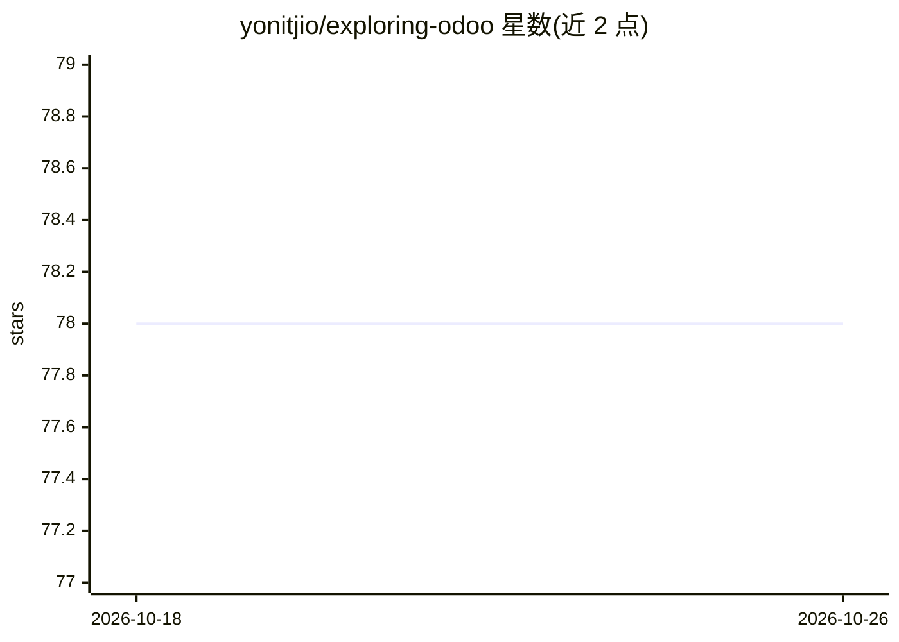

# yonitjio/exploring-odoo

⭐ 78 · JavaScript · MIT · 推送 2026-10-22 · [GitHub](https://github.com/yonitjio/exploring-odoo) · [官网](https://www.youtube.com/@exploring-odoo) · 组织维护

**Odoo 教学视频配套源码与节点式 UI 实验插件**

Exploring Odoo YouTube 频道的教学源码仓库，每个分支对应特定视频内容；同时托管 Nuido 与 N2 两个实验性 Odoo 插件，提供节点式用户界面。使用前须观看对应视频获取外部库与链接（如 Chart.js 扩展）。声明仅限学习探索用途，不提供技术支持、不接受 PR，模块维护与更新取决于社区参与度和后续视频计划，建议 git clone 而非 fork 以保持同步。

## 筛选速览

| 维度 | 判定 | 备注 |
|---|---|---|
| AI 角色 | `ai-knowledge` | 知识聚合/清单类 |
| 许可风险 | `permissive` | MIT |
| 部署形态 | `None` |  |
| 模型依赖 | — | README 未给出锁定关系 |
| 硬件要求 | — | 无带数字的原话,不猜 |
| 安装摩擦 | `low` | 无编译、无系统依赖或容器化 |
| 成熟度 | — | 结构信号不足 |

## 能力要点

- 分支与 YouTube 教学视频一一对应
- 包含 Nuido 与 N2 节点式 UI 实验性 Odoo 插件
- 仅测试视频所示场景，声明不用于生产环境

## 适用场景

- 跟随视频学习 Odoo 开发并对照源码
- 了解 Odoo 节点式 UI 插件的实验实现
- 参考教学示例自行探索 Odoo 扩展开发

## 场景标签

`教程课程` · 领域:学习与行业

## 证据(README 行号)

> L3: This repository contains the **source code** featured on the **Exploring Odoo YouTube channel**.
> L30: - This repo is an **archive** of examples from YouTube tutorials.

## 星数曲线

2026-10-18 78 → 2026-10-26 78（+0）

---
*卡片 v1 · prompt 1.4 · 生成 2026-10-24 · 置信度 low · 依据 README sha `80adc4900a81` · [字段定义](../../DATASET.md)*
