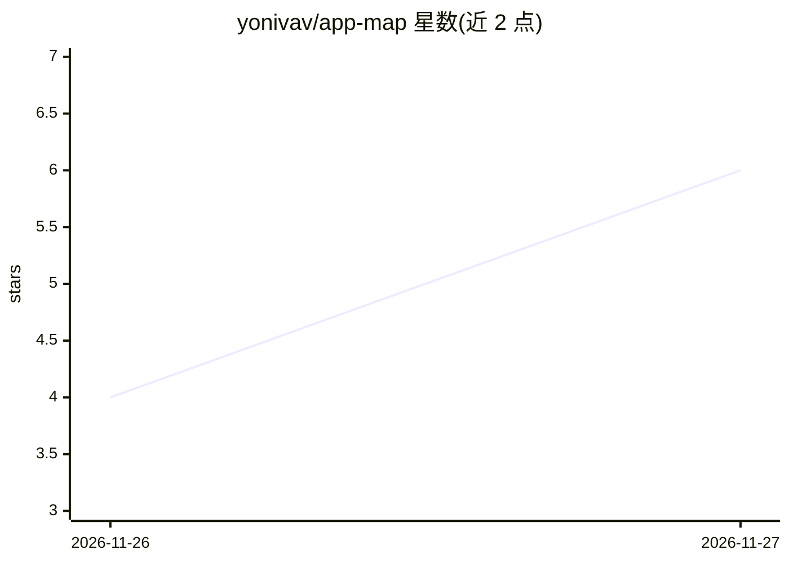

# yonivav/app-map

⭐ 6 · Python · MIT · 推送 2026-11-26 · [GitHub](https://github.com/yonivav/app-map) · [官网](https://yonivav.github.io/app-map/) · 个人维护

**给移动开发者的 AI agent 技能：生成可点击的代码架构图**

一个 Agent Skill（SKILL.md 加脚本），让 Claude Code、Cursor、Codex、Gemini CLI、GitHub Copilot 等 AI 编码助手为 Flutter、iOS、Android 应用生成可点击的 UML 架构图网站：每个图框可打开对应真实源码与界面截图。`--auto` 安装后，agent 修改代码时同步更新地图，并为每个 pull request 配置更新与校验 workflow（渲染失败或引用不存在的类名时 PR 失败）。解析基于 Dart analyzer 或 tree-sitter；截图需模拟器，不在 CI 运行。AI 用量费用由用户自己的 API key 承担。

## 筛选速览

| 维度 | 判定 | 备注 |
|---|---|---|
| AI 角色 | `ai-ecosystem` | LLM/agent 周边工具 |
| 许可风险 | `permissive` | MIT |
| 部署形态 | `None` |  |
| 模型依赖 | locked-api |  |
| 硬件要求 | — | 无带数字的原话,不猜 |
| 安装摩擦 | `low` | 无编译、无系统依赖或容器化 |
| 成熟度 | — | 结构信号不足 |

## 能力要点

- 可点击 UML 站点：图框打开真实源码与运行界面截图
- 支持 Flutter/Dart、Swift/Obj-C、Kotlin/Java 四类代码解析
- --auto 三层机制：编码时随改随更、PR 时 agent 更新、CI 校验地图
- 独立 CLI：build/changes/where/facts/verify/shots/crop

## 适用场景

- 新工程师或 AI agent 接手代码库前先看架构图上手
- 重构或跨平台移植前查看调用关系
- 让架构文档随每次 PR 自动更新
- 混合 Flutter 与原生代码的仓库统一阅读

## 场景标签

 · 领域:开发者工具/代码文档

## 证据(README 行号)

> L1: # App Map — an AI agent skill for mobile apps
> L88: App Map is an Agent Skill: a `SKILL.md` with scripts, in the open
> L64: |**While you code with an agent**|Every change the agent makes to a mapped module includes the map update: it runs 

## 星数曲线

2026-11-26 4 → 2026-11-27 6（+2）

---
*卡片 v1 · prompt 1.4 · 生成 2026-11-26 · 置信度 high · 依据 README sha `6f419b5ab907` · [字段定义](../../DATASET.md)*
