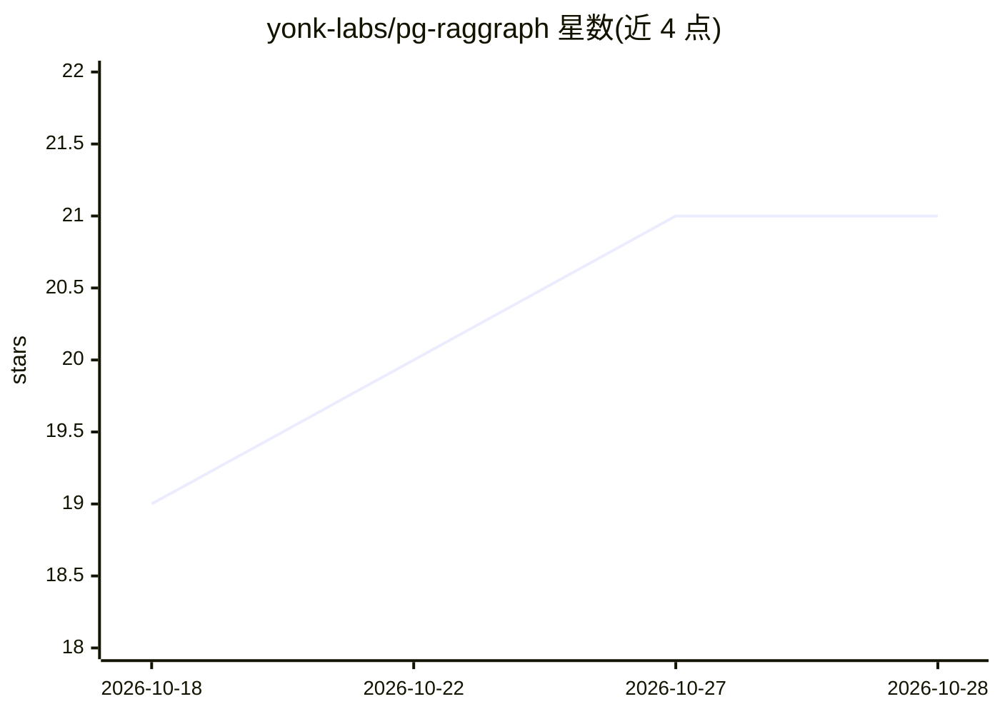

# yonk-labs/pg-raggraph

⭐ 21 · HTML · MIT · 推送 2026-08-29 · [GitHub](https://github.com/yonk-labs/pg-raggraph) · 组织维护

**在纯 PostgreSQL 上实现 GraphRAG 的 Python 检索库与工具集**

面向开发者的 Python 库：对文档目录做摄取（分块、嵌入、实体、关系、全文索引），返回组合向量相似度、BM25 与图遍历的查询 API，全部检索在单次 Postgres 往返内完成，依赖 pgvector、pg_trgm、递归 CTE 与 tsvector。图定位为增强层而非主体：向量+BM25 先行，1-hop 实体连接度重排或弱检索时图扩展。附带 CLI（pgrg）、可选 FastAPI 服务器（仅限本地开发）与面向 Claude Desktop/Cursor/Zed 的 MCP 服务器。提供同步与延迟抽取两种摄取模式，后者由后台 worker 补全实体关系。支持版本过滤与撤回感知查询，基准覆盖经典 GraphRAG、多跳 QA 与演进知识场景，并保留图无增益的结果。需 Postgres 16+ 与 pgvector/pg_trgm 扩展，alpha 阶段。

## 筛选速览

| 维度 | 判定 | 备注 |
|---|---|---|
| AI 角色 | `ai-ecosystem` | LLM/agent 周边工具 |
| 许可风险 | `permissive` | MIT |
| 部署形态 | `self-host` | docker 或自建部署 |
| 模型依赖 | local-ok | 支持本地模型 |
| 硬件要求 | — | 无带数字的原话,不猜 |
| 安装摩擦 | `low` | 无编译、无系统依赖或容器化 |
| 成熟度 | `idea` | |

## 能力要点

- 向量+BM25+图遍历合并为单条 SQL 查询，单次数据库往返
- 延迟摄取模式约 18ms/文档，后台 worker 补全实体/关系抽取
- MCP 服务器接入 Claude Desktop/Cursor/Zed，含 graph_ready 状态与 staleness 提示
- 版本过滤（13/13 纯度）与撤回感知/时间旅行查询（10/10 通过）

## 适用场景

- 在已有 PostgreSQL 上构建 GraphRAG 检索而不引入额外向量库或图库
- 代码库/技术文档问答与多跳实体推理
- 需按版本、时间点或撤回状态过滤答案来源的演进知识库
- 通过 MCP 让 Claude Desktop/Cursor/Zed 中的 agent 检索本地知识库

## 场景标签

`RAG` `知识图谱` `语义搜索` · 领域:知识与检索

## 证据(README 行号)

> L9: pg-raggraph is a Python library for **GraphRAG on plain PostgreSQL**. You point it at a directory of documents, it i
> L11: It is also a **full toolkit** around that library: a CLI (`pgrg`), an optional FastAPI server with a web UI, and an

## 星数曲线

2026-10-18 19 → 2026-10-28 21（+2）

---
*卡片 v1 · prompt 1.4 · 生成 2026-10-28 · 置信度 high · 依据 README sha `fef21d936af8` · [字段定义](../../DATASET.md)*
