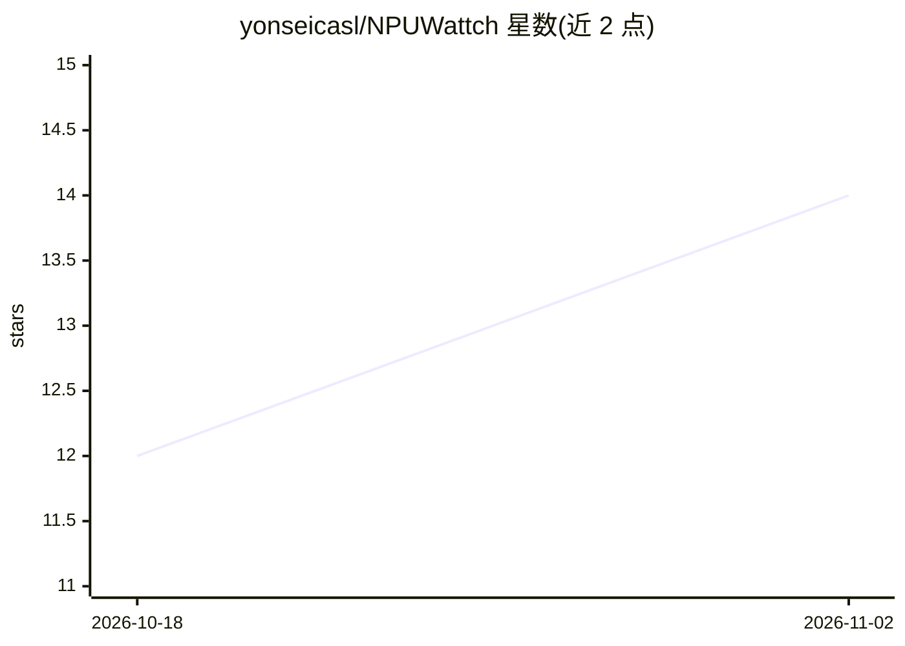

# yonseicasl/NPUWattch

⭐ 14 · Python · MIT · 推送 2026-10-28 · [GitHub](https://github.com/yonseicasl/NPUWattch) · 组织维护

**面向神经加速器的功耗/面积/时序 ML 建模工具**

NPUWattch 读入加速器架构描述（可选叠加模拟器记录的活动数据），输出各组件的能耗、面积与时序估计，汇成自包含 HTML 报告；模型基于整体化建模方法采集的实测数据训练。支持三种输入方式：PyTorchSim 运行输出、Accelergy/Timeloop 架构 YAML、以及原生描述文件加活动 CSV；无活动数据时回退到可调的 vectorless 估计。提供工艺节点/晶体管/电压/温度等参数与消息目录机制。面向硬件架构研究人员，以 HPCA 2026 论文发表。

## 筛选速览

| 维度 | 判定 | 备注 |
|---|---|---|
| AI 角色 | `ai-native` | 本体是模型或模型工具 |
| 许可风险 | `permissive` | MIT |
| 部署形态 | `library` | 以包/库形式分发 |
| 模型依赖 | — | README 未给出锁定关系 |
| 硬件要求 | — | 无带数字的原话,不猜 |
| 安装摩擦 | `low` | 无编译、无系统依赖或容器化 |
| 成熟度 | — | 结构信号不足 |

## 能力要点

- 三种输入通道：PyTorchSim 输出、Accelergy/Timeloop 架构 YAML、原生描述+活动 CSV
- 输出每组件能耗/面积估计与时序检查（f_max、关键路径）
- 无活动数据时回退 vectorless 估计（默认 25% 随机翻转率，可调）
- 教程含 AlexNet/ResNet-50/Llama-3-8B 在 Eyeriss/Gemmini/NVDLA/TPUv3 类阵列的实例

## 适用场景

- 评估候选 NPU 架构的功耗、面积与可达频率
- 对 Timeloop/PyTorchSim 仿真结果做逐组件能耗记账
- 比较不同工艺节点与工作点下的加速器开销

## 场景标签

 · 领域:计算机体系结构/硬件建模

## 证据(README 行号)

> L5: NPUWattch is an ML-based power, area, and timing (PAT) modeling tool. Given an accelerator
> L7: estimates of energy, area, and timing, collected into a self-contained HTML report. The models

## 星数曲线

2026-10-18 12 → 2026-11-02 14（+2）

---
*卡片 v1 · prompt 1.4 · 生成 2026-10-31 · 置信度 mid · 依据 README sha `746597ab11eb` · [字段定义](../../DATASET.md)*
