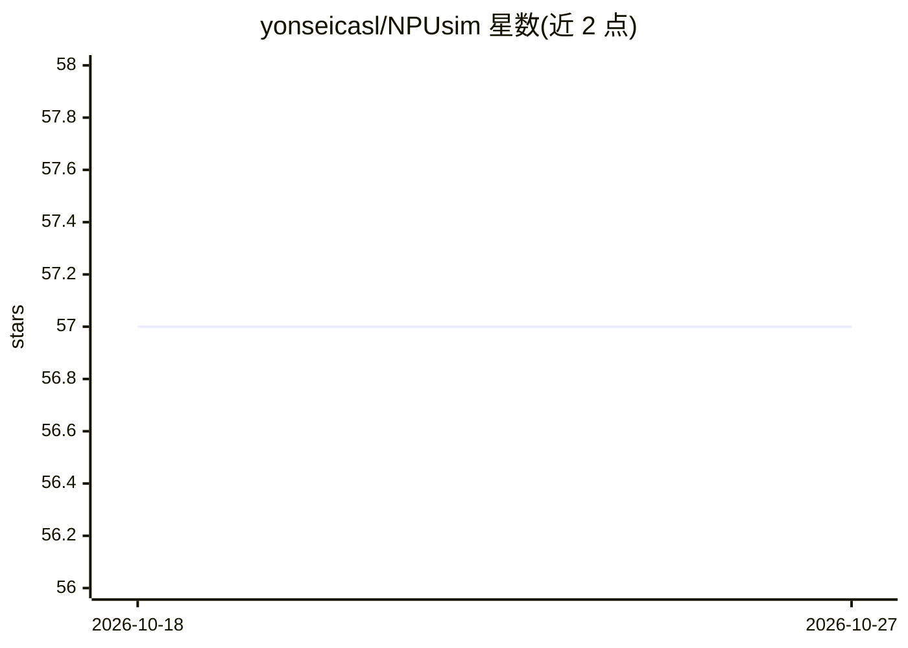

# yonseicasl/NPUsim

⭐ 57 · C++ · NOASSERTION · 推送 2026-10-20 · [GitHub](https://github.com/yonseicasl/NPUsim) · 组织维护

**DNN 加速器全模型周期级功能仿真框架**

延世大学计算机体系结构实验室开发的 DNN 加速器仿真框架，面向加速器设计空间探索与流片前分析。采用架构导向建模方式，将硬件组件显式建于神经网络嵌套循环之外，支持可配置数据流与映射、周期级时序仿真，以及带真实神经数据的模型内功能执行（可集成零跳过等值优化）。输入包括加速器规格、DNN 网络配置与调度表，通过 npusim.sh 脚本构建与运行仿真；C++ 实现需 g++ 编译，含 Nebula、DRAMsim3、PyTorch 扩展。

## 筛选速览

| 维度 | 判定 | 备注 |
|---|---|---|
| AI 角色 | `ai-ecosystem` | LLM/agent 周边工具 |
| 许可风险 | `none` | NOASSERTION |
| 部署形态 | `None` |  |
| 模型依赖 | — | README 未给出锁定关系 |
| 硬件要求 | — | 无带数字的原话,不猜 |
| 安装摩擦 | `medium` | 含编译或系统依赖之一 |
| 成熟度 | — | 结构信号不足 |

## 能力要点

- 架构导向建模：硬件组件显式建于嵌套循环之外
- 可配置数据流与映射，覆盖多种加速器设计
- 周期级时序仿真与带真实数据的功能执行
- 支持零跳过等值优化集成

## 适用场景

- DNN 加速器架构的设计空间探索
- 流片前评估加速器时序与能耗
- 研究值优化（如零跳过）对加速器执行的影响

## 场景标签

 · 领域:计算机体系结构/EDA仿真

## 证据(README 行号)

> L13: _NPUsim_ is a modeling framework for full-model, cycle-level, and value-aware functional simulations of DNN acceler
> L9: Rapid advancements in deep learning techniques have sparked competitive races to develop specialized hardware for ac

## 星数曲线

2026-10-18 57 → 2026-10-27 57（+0）

---
*卡片 v1 · prompt 1.4 · 生成 2026-10-24 · 置信度 high · 依据 README sha `e21f07eaa680` · [字段定义](../../DATASET.md)*
