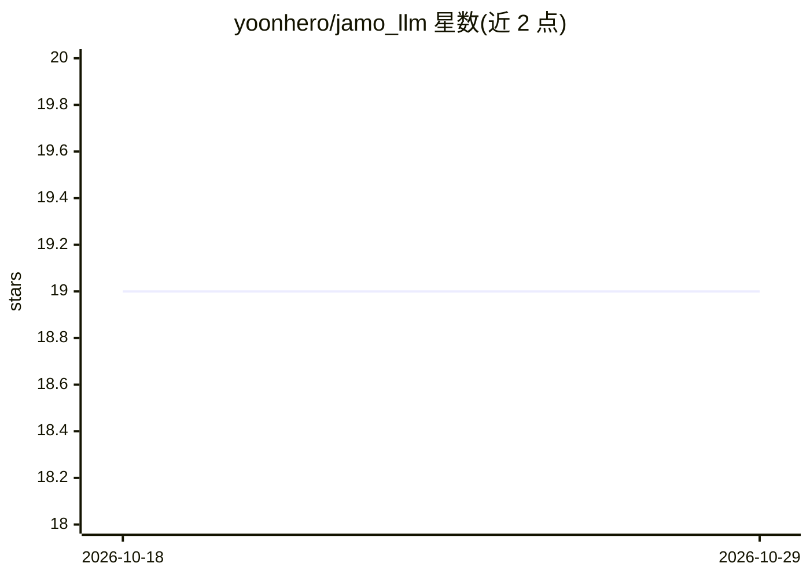

# yoonhero/jamo_llm

⭐ 19 · Python · 推送 2026-08-03 · [GitHub](https://github.com/yoonhero/jamo_llm) · 组织维护

**高中生开发的韩语小型 GPT 模型：可预训练、微调与对话推理**

基于 nanoGPT 与 GPT 架构的韩语 Little Language Model（JAMO 0.2B Small），由世马高中 R&E 研究团队开发，目标是在边缘设备上运行完整模型。提供预训练脚本（曾借 A100 以约 645 亿 token 训练约 12 天）、基于 KoAlpaca/Kullm 数据集的微调流程（报告 CPU 上亦可训练）与 generate.py 对话推理命令；0.2B 微调模型权重经 Google Drive 下载。--device auto 按 CUDA/MPS/CPU 顺序选择设备。

## 筛选速览

| 维度 | 判定 | 备注 |
|---|---|---|
| AI 角色 | `ai-native` | 本体是模型或模型工具 |
| 许可风险 | `none` | — |
| 部署形态 | `library` | 以包/库形式分发 |
| 模型依赖 | — | README 未给出锁定关系 |
| 硬件要求 | — | 无带数字的原话,不猜 |
| 安装摩擦 | `medium` | 含编译或系统依赖之一 |
| 成熟度 | — | 结构信号不足 |

## 能力要点

- 0.2B 参数韩语 GPT 架构模型，nanoGPT 基础上实验性采用多种技术
- 提供预训练、微调、对话推理的完整脚本流程
- 微调数据来自 KoAlpaca 与 Kullm 公开数据集
- 设备自动选择支持 CUDA/MPS/CPU

## 适用场景

- 在消费级或边缘设备上运行韩语对话小模型
- 学习小规模语言模型的预训练与微调流程
- 基于公开韩语指令数据进行二次微调实验

## 场景标签

`模型训练` `微调` · 领域:训练与推理

## 证据(README 行号)

> L45: 자모는 한국어 모델로 nanoGPT에 기반을 둔 프로젝트입니다.
> L35: python generate.py \

## 星数曲线

2026-10-18 19 → 2026-10-29 19（+0）

---
*卡片 v1 · prompt 1.4 · 生成 2026-10-28 · 置信度 mid · 依据 README sha `343213a74f29` · [字段定义](../../DATASET.md)*
