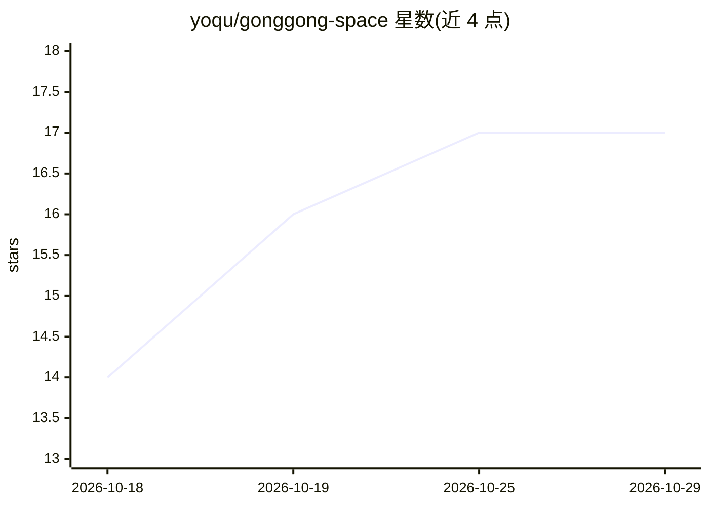

# yoqu/gonggong-space

⭐ 17 · TypeScript · Apache-2.0 · 推送 2026-10-28 · [GitHub](https://github.com/yoqu/gonggong-space) · [官网](https://yoqu.github.io/gonggong-space/) · 个人维护 · 中文 README

**小团队自托管 AI 协作平台：群里 @ 队友机器上的 Claude Code / Codex**

面向小团队的自托管群聊式 AI Agent 协作平台。成员通过 daemon（gg 命令行或 macOS 桌面端）把本机接入自托管服务器，机器上的 Claude Code / Codex 成为群内可 @ 的 Bot；未 @ 的消息也作为上下文带入，Bot 间可接力任务。Agent 经 ACP 接入，插件式适配层可扩展。模型调用从成员本机发出，服务器不保管凭据也不调用模型；支持三档权限与越权审批、diff/Git 状态查看、结果经隧道在群内预览。限制：支持 Agent 目前为 Claude Code 与 Codex 两类。

## 筛选速览

| 维度 | 判定 | 备注 |
|---|---|---|
| AI 角色 | `ai-ecosystem` | LLM/agent 周边工具 |
| 许可风险 | `permissive` | Apache-2.0 |
| 部署形态 | `self-host` | docker 或自建部署 |
| 模型依赖 | — | README 未给出锁定关系 |
| 硬件要求 | — | 无带数字的原话,不猜 |
| 安装摩擦 | `low` | 无编译、无系统依赖或容器化 |
| 成熟度 | — | 结构信号不足 |

## 能力要点

- 群聊 @ 派活，Agent 结果经隧道在群内直接预览
- Agent 经 ACP 接入，插件式适配层可扩展更多 Agent
- 三档权限与越权审批、审计记录，模型调用从本机发出不经服务器
- daemon 只向外连接，默认 npmmirror 镜像与内置模型厂商预设

## 适用场景

- 小团队把各自机器上的 Claude Code / Codex 接入群聊共同派活
- 团队共享 Agent 上下文，多人多 Bot 在同群接力任务
- 在群里直接预览 Bot 生成的网页、接口与报告

## 场景标签

 · 领域:开发者工具/团队协作

## 证据(README 行号)

> L25: 共工空间是面向小团队的自托管 AI 协作平台。每个成员把自己的机器接进来，机器上的 Claude Code / Codex 就成了群里可以 @ 的 **Bot**。人和 Bot 在同一个群里讨论、派活、接力，过程、改动和结果对全员
> L63: - 服务器只负责账号、群、消息路由、预览中继和审计，**不保管仓库凭据，也不调用模型**。
> L65: - Agent 经 ACP（Agent Client Protocol） 接入，适配层是插件式的，便于扩展更多 Agent。

## 星数曲线

2026-10-18 14 → 2026-10-29 17（+3）

---
*卡片 v1 · prompt 1.4 · 生成 2026-10-29 · 置信度 mid · 依据 README sha `7c657c511f8f` · [字段定义](../../DATASET.md)*
