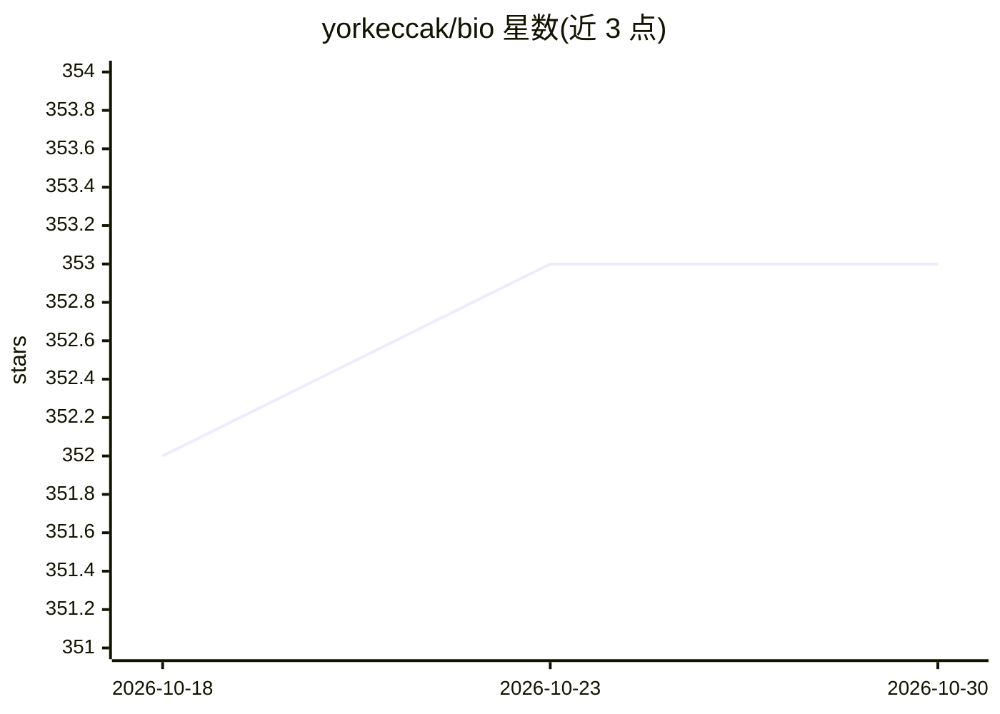

# yorkeccak/bio

⭐ 353 · TypeScript · MIT · 推送 2026-09-09 · [GitHub](https://github.com/yorkeccak/bio) · [官网](https://bio.valyu.ai) · 个人维护

**生物医药深度研究助手：对话式生成带引用的调研报告**

基于 Next.js 的生物医学研究 Web 应用：用户选择生命科学工作流（竞争格局、临床读出、监管先例、BD 扫描），填写变量后由 Valyu DeepResearch 检索 PubMed、ClinicalTrials.gov、FDA 药品标签、专利与开放网络，生成带内联引用的报告、结构化交付物与 PDF 导出。支持三种研究深度模式、实时活动流与报告历史。自托管模式用本地 SQLite、免登录、无速率限制，需自备 Valyu API key；可选检测本机 Ollama/LM Studio 作为本地模型服务。

## 筛选速览

| 维度 | 判定 | 备注 |
|---|---|---|
| AI 角色 | `ai-native` | 本体是模型或模型工具 |
| 许可风险 | `permissive` | MIT |
| 部署形态 | `library` | 以包/库形式分发 |
| 模型依赖 | local-ok | 支持本地模型 |
| 硬件要求 | — | 无带数字的原话,不猜 |
| 安装摩擦 | `low` | 无编译、无系统依赖或容器化 |
| 成熟度 | — | 结构信号不足 |

## 能力要点

- 预置生命科学工作流（Pipeline/临床/监管/BD 四类视角）生成带内联引用的报告
- 经 Valyu 统一 API 检索 PubMed、ClinicalTrials.gov、FDA 药品标签、专利等数据源
- fast/standard/heavy 三种研究模式，附实时活动流与报告历史
- 自托管模式：本地 SQLite、免认证、无速率限制

## 适用场景

- 调研某靶点类别的竞争格局与管线资产
- 汇总某适应症的临床试验与读出分析
- 梳理监管审批路径与先例
- 自助托管并私有保存研究数据

## 场景标签

`科研工具` · 领域:学习与行业

## 证据(README 行号)

> L12: > **Enterprise-grade biomedical deep research** - Pick a life sciences workflow, fill in a few variables, and get b
> L21: - **Comprehensive biomedical data** - PubMed articles, ClinicalTrials.gov records, FDA drug labels, patents, and mo

## 星数曲线

2026-10-18 352 → 2026-10-30 353（+1）

---
*卡片 v1 · prompt 1.4 · 生成 2026-10-21 · 置信度 mid · 依据 README sha `5264c304340f` · [字段定义](../../DATASET.md)*
