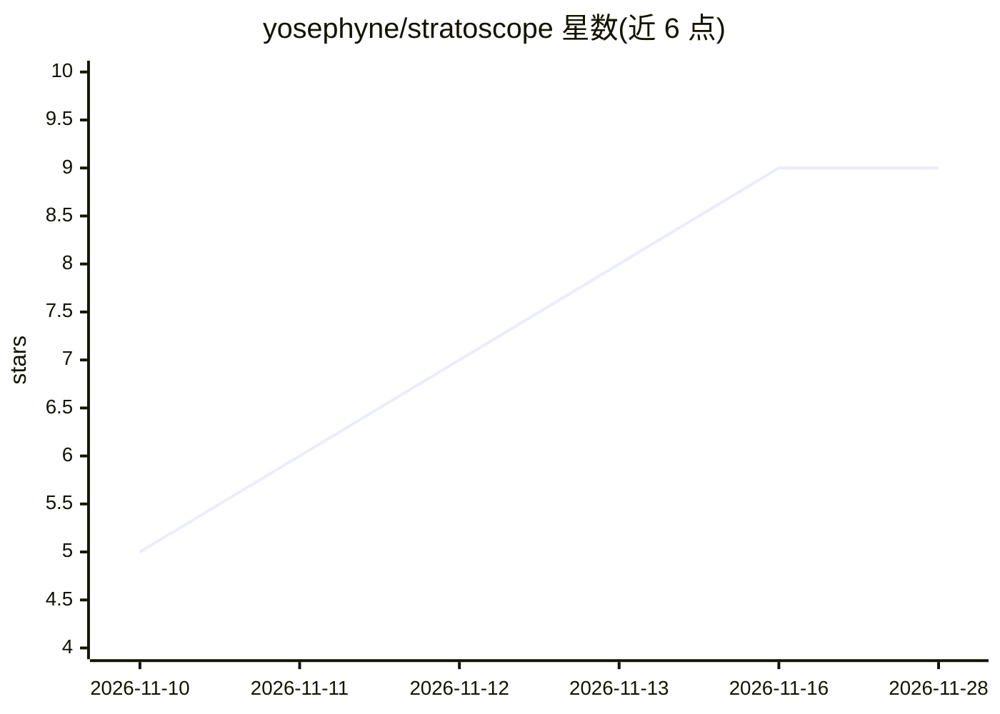

# yosephyne/stratoscope

⭐ 9 · C# · MIT · 推送 2026-11-22 · [GitHub](https://github.com/yosephyne/stratoscope) · 个人维护

**菜单栏实时仪表：显示本地 LLM 引擎的速度、缓存与资源**

运行于 macOS 菜单栏（或 Windows 任务栏）的监控应用，实时读取本地推理引擎的指标：prompt 读取（prefill）与解码速度、进度条、prompt 缓存命中比例（绿/黄/橙/灰四档着色）、上下文大小及近 12 次请求变化、RAM/GPU/CPU、缓存槽位与累计统计。当前仅支持 Strata 引擎（另有 demo 假数据模式），llama.cpp/MLX 等尚未支持；通过读取 Kilo/OpenCode 的客户端配置在上下文条上标出摘要线。提供 dmg/exe 安装包与源码构建路径，无遥测。

## 筛选速览

| 维度 | 判定 | 备注 |
|---|---|---|
| AI 角色 | `ai-ecosystem` | LLM/agent 周边工具 |
| 许可风险 | `permissive` | MIT |
| 部署形态 | `desktop` | 安装包/桌面程序 |
| 模型依赖 | — | README 未给出锁定关系 |
| 硬件要求 | — | 无带数字的原话,不猜 |
| 安装摩擦 | `medium` | 含编译或系统依赖之一 |
| 成熟度 | — | 结构信号不足 |

## 能力要点

- prefill/decode 实时速度（t/s）与带缓存着色的进度条
- 上下文大小、近 12 次请求速度、RAM/GPU/CPU 与缓存槽位面板
- 从 Kilo/OpenCode 客户端配置读取上下文摘要位置，不读取密钥
- 引擎适配器架构：HTTP 暴露指标的引擎可用单文件适配器接入

## 适用场景

- 本地跑 Strata 时在菜单栏查看推理速度与 GPU/RAM 占用
- 通过缓存颜色判断 prompt 复用情况、排查等待
- 用 demo 模式在不接引擎的情况下查看界面

## 场景标签

 · 领域:本地 LLM 推理监控/桌面工具

## 证据(README 行号)

> L14: Stratoscope shows what your local LLM inference engine is doing right now, in the macOS menu bar or the Windows tas
> L71: ## Supported inference engines
> L79: Each inference engine has a small adapter that turns its metrics into one common format. The menu only knows that f

## 星数曲线

2026-11-10 5 → 2026-11-28 9（+4）

---
*卡片 v1 · prompt 1.4 · 生成 2026-11-20 · 置信度 high · 依据 README sha `8e89d390be09` · [字段定义](../../DATASET.md)*
