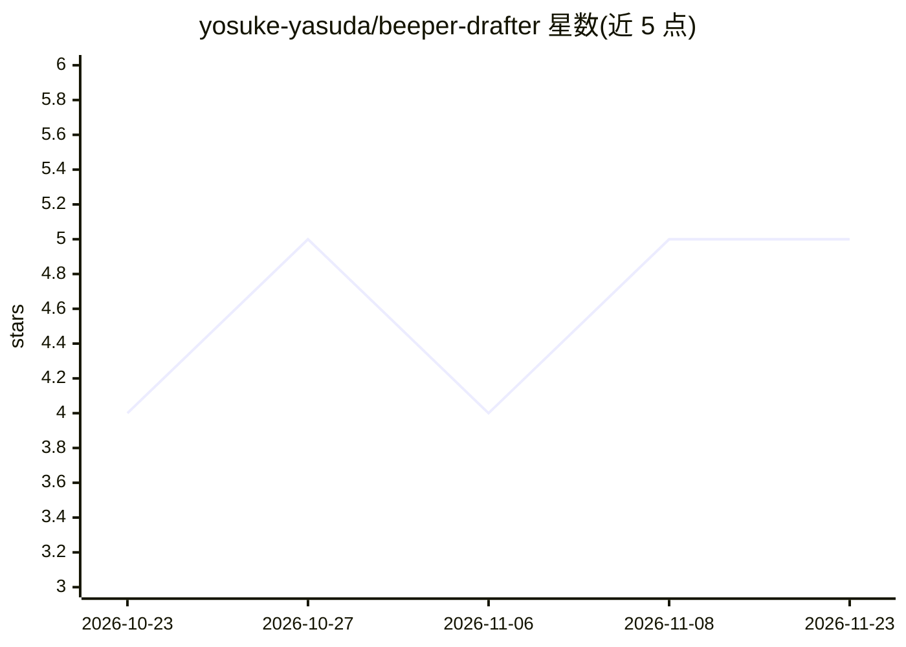

# yosuke-yasuda/beeper-drafter

⭐ 5 · JavaScript · MIT · 推送 2026-10-21 · [GitHub](https://github.com/yosuke-yasuda/beeper-drafter) · 个人维护

**监视 Beeper 收件箱并代拟聊天回复草稿的工具**

监听 Beeper Desktop 的本地 WebSocket 事件，新消息到达时调用 OpenAI Codex CLI 或 Claude Code 判断是否需要回复，并将生成的草稿写入 Beeper 聊天输入框，发送仍由用户完成。只在草稿框为空时写入，不覆盖用户已输入内容。支持可配置的轻量 System 1 过滤门先行判断是否需要回复，以及通过自定义规则在你发出消息后触发 MCP 工具动作。单文件 Node.js 脚本，无 npm 依赖，需 Node.js 22.9+ 与已登录的 Beeper Desktop。

## 筛选速览

| 维度 | 判定 | 备注 |
|---|---|---|
| AI 角色 | `ai-native` | 本体是模型或模型工具 |
| 许可风险 | `permissive` | MIT |
| 部署形态 | `library` | 以包/库形式分发 |
| 模型依赖 | local-ok | 支持本地模型 |
| 硬件要求 | — | 无带数字的原话,不猜 |
| 安装摩擦 | `low` | 无编译、无系统依赖或容器化 |
| 成熟度 | — | 结构信号不足 |

## 能力要点

- AI 生成的回复仅写入草稿框，从不代为发送
- 自动跳过感谢、营销、群聊未被点名等无需回复的消息
- 可选 System 1 轻量门控先行过滤，本地或远程模型均可
- 自定义 ACTIONS.md 规则触发 MCP 工具动作（如写日历）

## 适用场景

- 让 AI 为 WhatsApp/iMessage/Telegram/Discord 等多平台消息预写回复草稿
- 过滤营销与群聊通知，只对需要亲自回复的消息生成草稿
- 在本地运行模型做免费的消息过滤门控

## 场景标签

`AI 助手` · 领域:对话与助手

## 证据(README 行号)

> L15: `beeper-drafter` watches your Beeper inbox (WhatsApp, iMessage, Telegram, Discord, Slack, Signal, Instagram…). When
> L22: - **It never sends anything.** It only fills in the draft box, and only if the box is empty. It never overwrites wh

## 星数曲线

2026-10-23 4 → 2026-11-23 5（+1）

---
*卡片 v1 · prompt 1.4 · 生成 2026-11-21 · 置信度 high · 依据 README sha `e091a3db6b47` · [字段定义](../../DATASET.md)*
