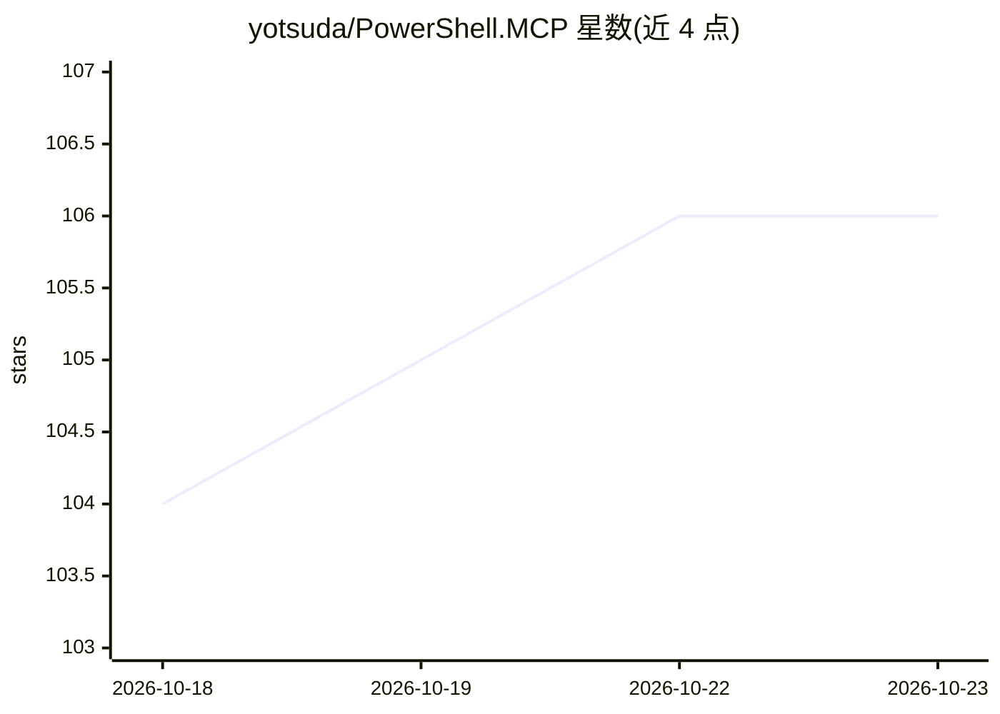

# yotsuda/PowerShell.MCP

⭐ 106 · C# · MIT · 推送 2026-10-20 · [GitHub](https://github.com/yotsuda/PowerShell.MCP) · [官网](https://www.powershellgallery.com/packages/PowerShell.MCP) · 个人维护

**通用 MCP 服务器：让 AI 客户端直接访问 PowerShell 生态与任意 CLI**

面向 Claude Code、Claude Desktop 等 MCP 客户端的 PowerShell 接入服务器：通过一个 MCP server 向 AI 开放 PowerShell Gallery 的 10,000+ 模块和任意 CLI 工具（git、docker、kubectl、gh 等）。采用共享控制台模式——用户与 AI 在同一个 PowerShell 会话中协作，命令实时可见并可用 transcript 审计；提供 12 个工具，其中 6 个用于本机控制台、6 个用于远程控制台。凭据通过交互式提示输入且对 AI 隐藏。需 PowerShell 7.4+，支持 Windows/Linux/macOS，安装后需注册到 MCP 客户端并在更新后重新注册。README 顶部含安全警告：该模块提供完整的系统访问能力。

## 筛选速览

| 维度 | 判定 | 备注 |
|---|---|---|
| AI 角色 | `ai-ecosystem` | LLM/agent 周边工具 |
| 许可风险 | `permissive` | MIT |
| 部署形态 | `desktop` | 安装包/桌面程序 |
| 模型依赖 | locked-api |  |
| 硬件要求 | — | 无带数字的原话,不猜 |
| 安装摩擦 | `medium` | 含编译或系统依赖之一 |
| 成熟度 | — | 结构信号不足 |

## 能力要点

- 单个 MCP server 接入 10,000+ PowerShell 模块与任意 CLI 工具
- 用户与 AI 共享同一 PowerShell 控制台，命令实时可见、可转录审计
- 12 个工具覆盖本机与远程控制台的启动/执行/取消/断开
- 凭据（MFA、密码、签名口令）经交互提示输入，不进入 AI 输出流

## 适用场景

- 让 Claude Code 等客户端直接调用 Az/AWS.Tools 等 PowerShell 模块完成云上运维
- 在可见的控制台中监督 AI 执行的每条命令并留存审计记录
- 用自然语言描述任务，由 AI 组合跨服务 PowerShell 管道

## 场景标签

 · 领域:开发者工具/MCP 基础设施

## 证据(README 行号)

> L13: *The universal MCP server—one installation gives AI access to 10,000+ PowerShell modules and any CLI tool.*
> L25: PowerShell.MCP takes a different approach from service-specific MCP servers. Rather than providing curated tools fo
> L73: - Each client instance gets its own exclusive console—run multiple Claude Code sessions in parallel

## 星数曲线

2026-10-18 104 → 2026-10-23 106（+2）

---
*卡片 v1 · prompt 1.4 · 生成 2026-10-23 · 置信度 high · 依据 README sha `29790bfa207b` · [字段定义](../../DATASET.md)*
