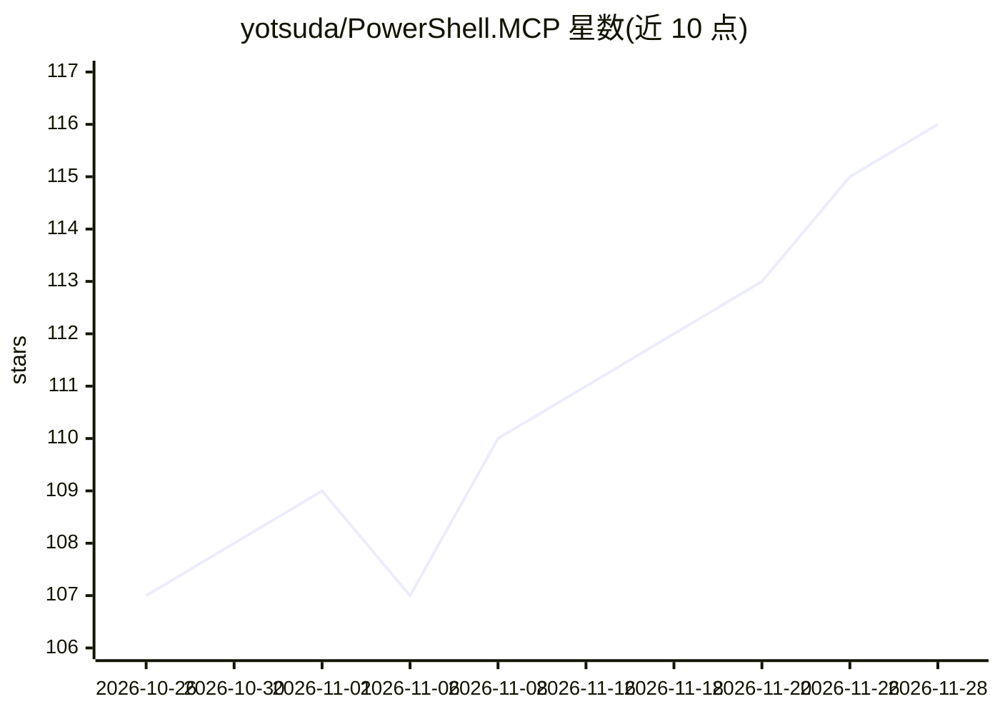

# yotsuda/PowerShell.MCP

⭐ 116 · C# · MIT · 推送 2026-11-21 · [GitHub](https://github.com/yotsuda/PowerShell.MCP) · [官网](https://www.powershellgallery.com/packages/PowerShell.MCP) · 个人维护

**让 MCP 客户端在可见控制台中运行 PowerShell 与 CLI 的服务器**

一个 MCP 服务器：AI 客户端（如 Claude Code/Claude Desktop）经其在本机桌面打开的 PowerShell 控制台中执行命令与 CLI 工具，用户可实时查看每条命令、代输密码/MFA、随时关窗终止命令，并可为 AI 临时授予或收回管理员权限。支持持久会话、最多四个远程机器控制台、文本文件编辑 cmdlet；默认仅用命名管道本地通信。安装依赖 PowerShell 7.4+，经 PowerShell Gallery 分发，支持 Windows/Linux/macOS。

## 筛选速览

| 维度 | 判定 | 备注 |
|---|---|---|
| AI 角色 | `ai-ecosystem` | LLM/agent 周边工具 |
| 许可风险 | `permissive` | MIT |
| 部署形态 | `desktop` | 安装包/桌面程序 |
| 模型依赖 | locked-api |  |
| 硬件要求 | — | 无带数字的原话,不猜 |
| 安装摩擦 | `low` | 无编译、无系统依赖或容器化 |
| 成熟度 | — | 结构信号不足 |

## 能力要点

- 共享控制台：实时查看命令、交互提示与密码由用户本人输入
- 10,000+ PowerShell Gallery 模块与任意 CLI 经 Get-Help 供 AI 调用
- 会话持久化：认证一次，模块/变量/函数保持加载
- 远程控制台配对连接（TCP 42777），一个会话驱动最多四台机器

## 适用场景

- 让 AI 用 Az/AWS.Tools 等模块查询和管理云资源
- AI 协助做网络安全审计，用户逐条监督并批准修复
- 通过对话在多台机器上执行运维命令

## 场景标签

`AI 助手` `网络安全` · 领域:对话与助手

## 证据(README 行号)

> L13: *One MCP server that gives AI access to 10,000+ PowerShell modules and any CLI tool — in a console you can see, wit
> L102: - Claude Code, Claude Desktop, or any MCP client

## 星数曲线

2026-10-26 107 → 2026-11-28 116（+9）

---
*卡片 v1 · prompt 1.4 · 生成 2026-11-28 · 置信度 high · 依据 README sha `ab2c69a4cb75` · [字段定义](../../DATASET.md)*
