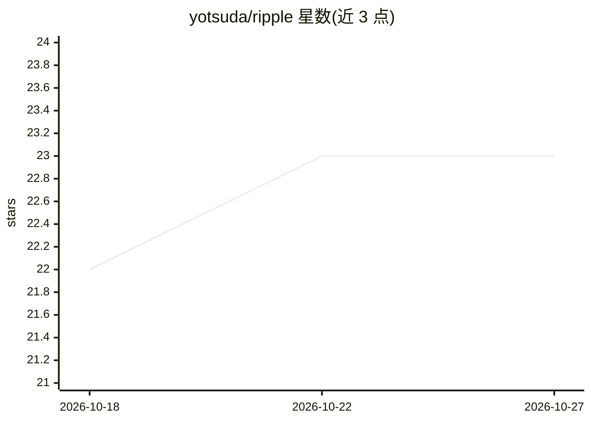

# yotsuda/ripple

⭐ 23 · C# · MIT · 推送 2026-05-26 · [GitHub](https://github.com/yotsuda/ripple) · [官网](https://www.npmjs.com/package/@ytsuda/ripple) · 个人维护

**共享终端的 MCP 服务器：AI 与人在同一 REPL 会话协同操作**

面向 MCP 客户端的 stdio 服务器，让 AI 在持久的可见终端窗口中运行 shell、语言 REPL 与调试器：19 个适配器覆盖 pwsh/bash/zsh/cmd、12 种 REPL 与 3 种调试器，通过 ConPTY 与 OSC 633 标记追踪命令生命周期、cwd 与退出码；会话跨 AI 客户端重启存活，支持多 shell 自动路由、交互提示中由用户亲自输入密码/MFA、send_input 处理挂起命令。Windows 为主要平台，Linux/macOS 可用；提供 npx 分发的 NativeAOT 单文件二进制与 dotnet 源码构建。

## 筛选速览

| 维度 | 判定 | 备注 |
|---|---|---|
| AI 角色 | `ai-ecosystem` | LLM/agent 周边工具 |
| 许可风险 | `permissive` | MIT |
| 部署形态 | `desktop` | 安装包/桌面程序 |
| 模型依赖 | — | README 未给出锁定关系 |
| 硬件要求 | — | 无带数字的原话,不猜 |
| 安装摩擦 | `medium` | 含编译或系统依赖之一 |
| 成熟度 | — | 结构信号不足 |

## 能力要点

- 19 个 YAML 声明式适配器（4 shell、12 REPL、3 调试器）
- 会话持久：AI 客户端重启不丢失已加载模块与变量
- ConPTY + OSC 633 标记解析，无输出静默启发式与提示符探测
- 用户在同一终端窗口输入密码/MFA，AI 不可见密钥内容

## 适用场景

- 让 AI 使用 PowerShell Az 模块等高冷启动成本的工作负载，只付一次导入开销
- AI 与用户共享同一 pdb/jdb 调试会话，逐步排查修复
- 含代码签名、MFA 等交互环节的流水线中由人补输入、AI 编排其余步骤

## 场景标签

`Agent 框架` · 领域:Agent 开发

## 证据(README 行号)

> L1: # Ripple — REPL-sharing MCP for AI Co-Driving
> L5: **A REPL-sharing MCP server for AI that actually holds a session.** Shell, Python, Node, a language debugger — whate
> L123: ripple runs as a stdio MCP server. When the AI calls `start_console`, ripple spawns itself in `--console` mode as 

## 星数曲线

2026-10-18 22 → 2026-10-27 23（+1）

---
*卡片 v1 · prompt 1.4 · 生成 2026-10-27 · 置信度 high · 依据 README sha `960727bf4b28` · [字段定义](../../DATASET.md)*
