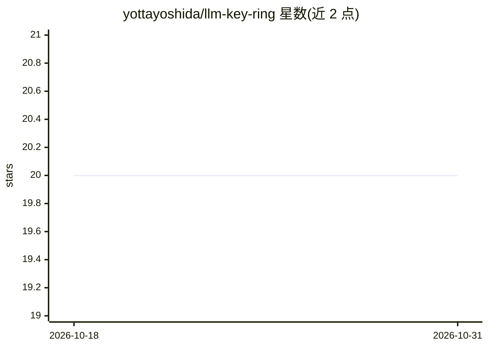

# yottayoshida/llm-key-ring

⭐ 20 · Rust · Apache-2.0 · 推送 2026-09-23 · [GitHub](https://github.com/yottayoshida/llm-key-ring) · 个人维护

**macOS CLI：把 LLM API 密钥加密存入 Keychain 并安全注入**

Rust 编写的 macOS 命令行工具 lkr，将 LLM API 密钥以 provider:label 命名存入专用 Keychain（v0.3.0 为独立 lkr.keychain-db，含 ACL 与 cdhash 二进制完整性绑定）。提供 set/get/list/rm/exec/gen/migrate/harden 等命令：exec 将 runtime 密钥注入子进程环境变量，gen 从 .env/JSON 模板生成 0600 权限配置文件；v0.2.0 起 TTY guard 阻断非交互环境的 get/gen 访问以抵御 AI agent 注入式窃取。仅支持 macOS，源码构建需 Rust 1.85+。注意：README 声明项目不再积极维护。

## 筛选速览

| 维度 | 判定 | 备注 |
|---|---|---|
| AI 角色 | `ai-ecosystem` | LLM/agent 周边工具 |
| 许可风险 | `permissive` | Apache-2.0 |
| 部署形态 | `library` | 以包/库形式分发 |
| 模型依赖 | — | README 未给出锁定关系 |
| 硬件要求 | — | 无带数字的原话,不猜 |
| 安装摩擦 | `low` | 无编译、无系统依赖或容器化 |
| 成熟度 | — | 结构信号不足 |

## 能力要点

- 密钥存入专用 macOS Keychain，lkr exec 以环境变量注入子进程且不落盘
- TTY guard 阻断非交互环境的 get/gen 访问（v0.2.0，防 agent 窃取）
- gen 从 .env/JSON 模板生成 0600 权限配置，clipboard 30 秒自动清除
- lkr usage 查询各 provider API 用量成本

## 适用场景

- 把 .env 明文密钥迁移到 macOS Keychain 加密存储
- 以 lkr exec 向脚本安全注入 OPENAI_API_KEY 等环境变量
- 阻断 AI 编码助手经 prompt injection 窃取密钥的路径

## 场景标签

 · 领域:开发工具/密钥管理

## 证据(README 行号)

> L9: A secure CLI tool for managing LLM API keys via macOS Keychain. No more plaintext keys in `.env` files.
> L85: lkr exec -- python script.py                # Inject all runtime keys

## 星数曲线

2026-10-18 20 → 2026-10-31 20（+0）

---
*卡片 v1 · prompt 1.4 · 生成 2026-10-28 · 置信度 high · 依据 README sha `8e2c46446cf9` · [字段定义](../../DATASET.md)*
