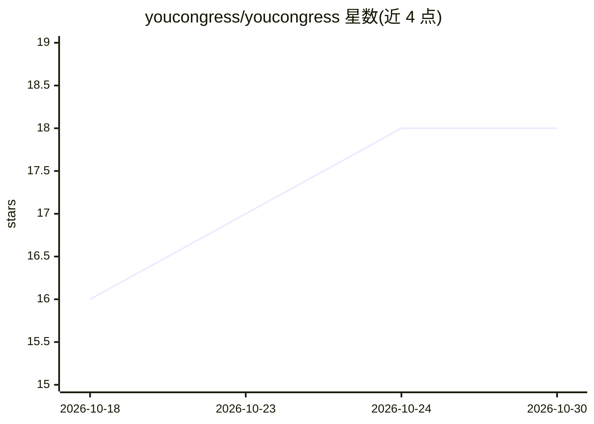

# youcongress/youcongress

⭐ 18 · Elixir · MIT · 推送 2026-10-26 · [GitHub](https://github.com/youcongress/youcongress) · [官网](https://youcongress.org) · 个人维护

**AI 治理领域有出处语录数据库，附流动民主参与层**

非营利开源开放数据平台，围绕公共议题构建有出处依据的知识库。数据层将公共讨论转化为可核查的语录—声明记录：保留原文引述、作者、来源与日期，附声明关联、立场标注（For/Abstain/Against）与多轮验证历史；采集与验证由应用工作流和定时 coding-agent 任务完成，支持 CSV 导出与 MCP 端点查询。参与层（beta）提供直接投票、委托与政策讨论界面。首个聚焦领域为 AI 治理与安全。技术栈为 Elixir/Phoenix，需 PostgreSQL。

## 筛选速览

| 维度 | 判定 | 备注 |
|---|---|---|
| AI 角色 | `ai-knowledge` | 知识聚合/清单类 |
| 许可风险 | `permissive` | MIT |
| 部署形态 | `None` |  |
| 模型依赖 | — | README 未给出锁定关系 |
| 硬件要求 | — | 无带数字的原话,不猜 |
| 安装摩擦 | `low` | 无编译、无系统依赖或容器化 |
| 成熟度 | `idea` | |

## 能力要点

- 语录记录保留原文与出处，附声明关联与立场标注
- 采集与验证流程：发现→抽取→关联→保真度/相关性/立场核查
- 完整 CSV 数据集导出与无 key MCP 端点查询
- 参与层提供直接投票、委托与政策讨论（beta）

## 适用场景

- 检索谁在哪份来源中对 AI 治理议题持何种立场
- 为研究导出有出处的语录-声明数据集
- 通过 MCP 端点将数据接入下游 AI 系统
- 参与对公共议题的投票与委托讨论

## 场景标签

 · 领域:AI 治理/开放数据/公民科技

## 证据(README 行号)

> L5: - **Data layer:** a provenance-preserving ingestion and structure layer that turns public discourse into inspectable
> L8: The project’s first large focus is AI governance, safety, regulation, labour impacts, compute governance, and intern
> L33: - Download the complete CSV dataset, or export sourced quotes from an individual statement page. The complete expor

## 星数曲线

2026-10-18 16 → 2026-10-30 18（+2）

---
*卡片 v1 · prompt 1.4 · 生成 2026-10-29 · 置信度 high · 依据 README sha `f90387eabb01` · [字段定义](../../DATASET.md)*
