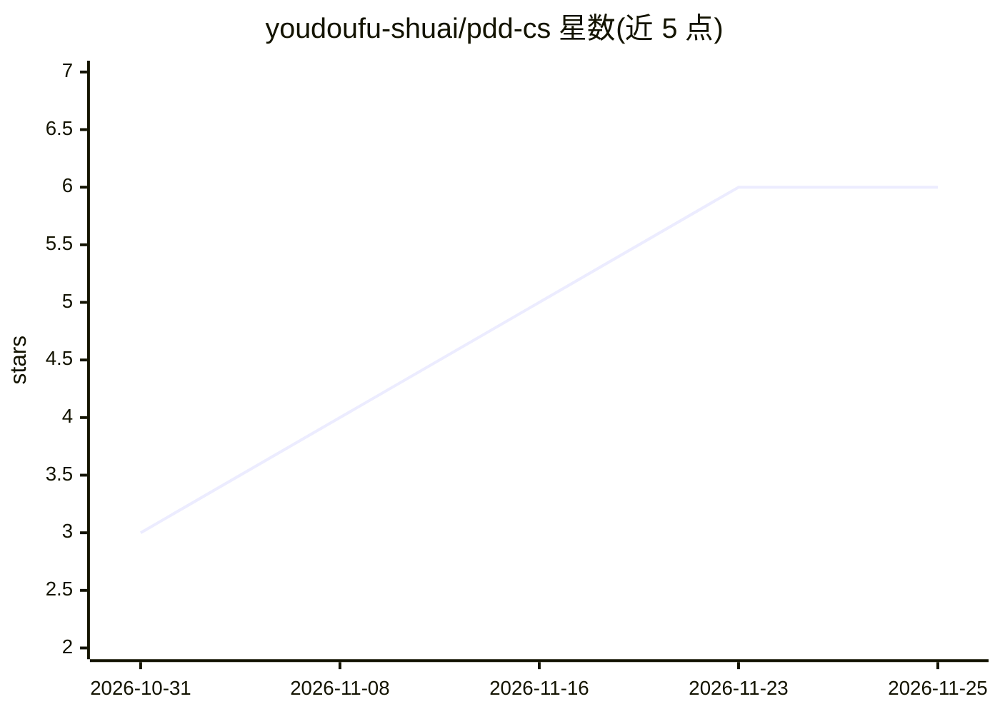

# youdoufu-shuai/pdd-cs

⭐ 6 · Python · AGPL-3.0 · 推送 2026-11-13 · [GitHub](https://github.com/youdoufu-shuai/pdd-cs) · 个人维护 · 中文 README

**拼多多多店铺自动客服：规则+可选AI自动接待**

面向自有拼多多店铺的多店铺客服系统：汇总各店铺进线与会话状态，按关键词规则与商品规则自动回复，售后、投诉及不确定问题转人工队列；提供运营面板查看首响指标、话术命中、风险记录与会话质检，并可导出复盘。AI 回复为可选项，配置支持 Chat Completions 的服务地址与凭据后启用。支持 Docker/systemd 服务器部署、健康探针、离线自检命令 doctor 与 SQLite 数据备份流程。README 提醒第三方工具需遵守平台现行规则并安排人工值守。

## 筛选速览

| 维度 | 判定 | 备注 |
|---|---|---|
| AI 角色 | `ai-native` | 本体是模型或模型工具 |
| 许可风险 | `viral` | AGPL-3.0 |
| 部署形态 | `library` | 以包/库形式分发 |
| 模型依赖 | — | README 未给出锁定关系 |
| 硬件要求 | — | 无带数字的原话,不猜 |
| 安装摩擦 | `low` | 无编译、无系统依赖或容器化 |
| 成熟度 | — | 结构信号不足 |

## 能力要点

- 关键词/商品规则自动回复与转人工队列分流
- 可选 AI 回复：配置任意 Chat Completions 兼容服务地址与凭据
- 运营面板含首响指标、话术命中、质检与会话导出
- 健康探针 /healthz 与 doctor --offline 离线自检

## 适用场景

- 多个自有拼多多店铺统一面板接待与值守
- 把有明确规则的咨询交给自动回复、售前投诉留给人工
- 导出会话做内部服务复盘与质检

## 场景标签

`聊天机器人` · 领域:对话与助手

## 证据(README 行号)

> L3: 面向自有店铺的多店铺客服助手。用一个面板查看进线、待人工处理的会话和回复质检；有明确规则的咨询交给自动回复，售后、投诉和不确定的问题留给人工。
> L21: **AI 是可选项。** 不填 API Key 仍可用关键词规则、默认回复、待处理队列和人工转接。需要 AI 时，在「系统设置」配置支持 Chat Completions 的服务地址、模型和凭据。现有接口按静态 Bearer 凭据
> L39: |日常接待|配置关键词、商品规则、营业时间、默认回复及可选 AI 知识库|

## 星数曲线

2026-10-31 3 → 2026-11-25 6（+3）

---
*卡片 v1 · prompt 1.4 · 生成 2026-11-21 · 置信度 mid · 依据 README sha `9a1cfcff16ad` · [字段定义](../../DATASET.md)*
