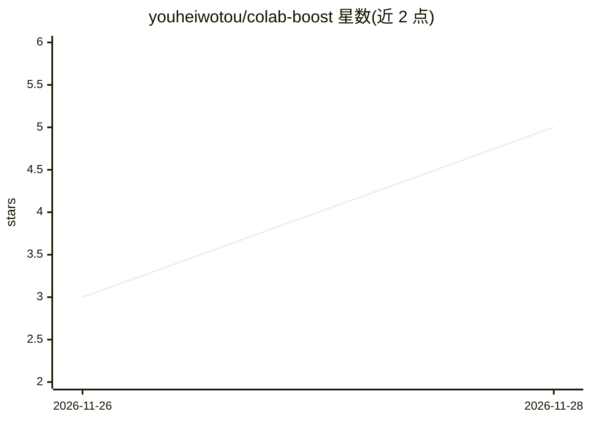

# youheiwotou/colab-boost

⭐ 5 · Python · MIT · 推送 2026-11-21 · [GitHub](https://github.com/youheiwotou/colab-boost) · 个人维护 · 中文 README

**给 Windows 用户的 Colab GPU 多账号部署与算力护栏控制台**

面向 Windows 本地环境的 Google Colab GPU 控制台：通过 HTTPS + Jupyter Kernel WebSocket 直连云端（免 WSL），提供多 Google 账号独立凭据管理与 CCU 余额监控、按显存阈值（如 70GB）自动退回重抽 A100、VM 内看门狗与本地巡检的双层自动关机护栏、孤儿实例检测与 JSON 关闭回执。内置 5 套部署配方（GGUF/llama.cpp、vLLM、ComfyUI、MiniMax-H3、Faster-Whisper）并自动做本地端口映射；支持演示沙盒模式（0 计费）与 CLI/HTTP API 调度，非回环绑定需配置 Bearer 鉴权。

## 筛选速览

| 维度 | 判定 | 备注 |
|---|---|---|
| AI 角色 | `ai-ecosystem` | LLM/agent 周边工具 |
| 许可风险 | `permissive` | MIT |
| 部署形态 | `desktop` | 安装包/桌面程序 |
| 模型依赖 | local-ok | 支持本地模型 |
| 硬件要求 | — | 无带数字的原话,不猜 |
| 安装摩擦 | `medium` | 含编译或系统依赖之一 |
| 成熟度 | — | 结构信号不足 |

## 能力要点

- 多账号 OAuth 凭据隔离存储（OS Keyring）与同屏 CCU 余额/消耗速率查看
- 显存阈值自动 unassign 重抽，避免抽到小显存实例
- VM 内看门狗 + 本地巡检双层自动关机与关闭回执落盘审计
- 5 套一键部署配方并自动映射端口到本地

## 适用场景

- 在 Windows 工作站上免 WSL 管理 Colab GPU 实例
- 大模型部署时锁定指定显存规格（如 A100 80GB）
- 防止云端 GPU 忘关导致持续计费
- 快速部署 GGUF 推理、语音转写或 ComfyUI 工作台

## 场景标签

`图像生成` `语音识别` `推理引擎` · 领域:内容生成

## 证据(README 行号)

> L3: > **属于我们自己的 Google Colab 模型极速部署与算力护栏控制台** — 原生支持 Windows（免 WSL / 免外部 CLI）、多账号算力实时监控、显存保底自动重抽（如锁 80GB A100 / 96GB G4）
> L16: |**开箱即用模型配方**|仅支持单一 GGUF 或每次手动执行繁琐编译脚本|内置 **5 套生产级部署配方**：`GGUF (llama.cpp 预编译 CUDA)`、`vLLM 高吞吐推理`、`ComfyUI 视觉/视频工作台

## 星数曲线

2026-11-26 3 → 2026-11-28 5（+2）

---
*卡片 v1 · prompt 1.4 · 生成 2026-11-26 · 置信度 high · 依据 README sha `fc42ef5d89ec` · [字段定义](../../DATASET.md)*
