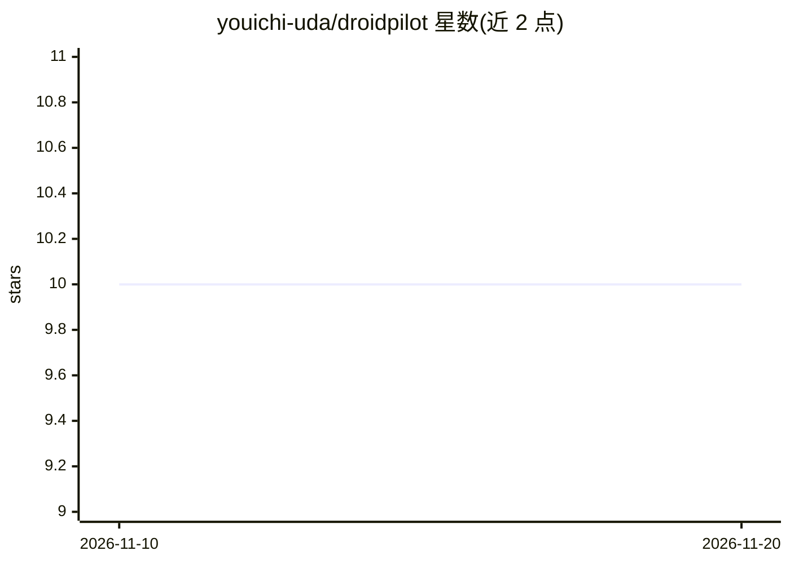

# youichi-uda/droidpilot

⭐ 10 · Kotlin · MIT · 推送 2026-06-06 · [GitHub](https://github.com/youichi-uda/droidpilot) · 个人维护

**让 AI agent 通过 MCP 稳定自动化操控 Android 设备**

DroidPilot 由两部分组成：Android 端 APK（Kotlin 编写）通过系统无障碍服务直接读取 UI 树并执行手势/输入，MCP Server（Node.js/TypeScript）经 WebSocket 在 WiFi/局域网内与设备通信，向 MCP 客户端暴露 18 个工具（点击、滑动、输入、截图、查找元素、启动应用等）。不依赖 ADB、USB 或 OCR 截图识别，以结构化 UI 数据降低 token 消耗；通信限局域网，支持可选认证 token。要求 Android 11+。

## 筛选速览

| 维度 | 判定 | 备注 |
|---|---|---|
| AI 角色 | `ai-ecosystem` | LLM/agent 周边工具 |
| 许可风险 | `permissive` | MIT |
| 部署形态 | `library` | 以包/库形式分发 |
| 模型依赖 | — | README 未给出锁定关系 |
| 硬件要求 | — | 无带数字的原话,不猜 |
| 安装摩擦 | `low` | 无编译、无系统依赖或容器化 |
| 成熟度 | — | 结构信号不足 |

## 能力要点

- 基于 Android 无障碍服务的原生 UI 树访问与手势执行，无需 ADB/USB/OCR
- 提供 18 个 MCP 工具，兼容 Claude Desktop、Claude Code 等任意 MCP 客户端
- 结构化 UI 数据替代图像分析，降低 LLM token 成本
- 通信限局域网 WebSocket，支持可选认证 token，不向外部服务器发送数据

## 适用场景

- 让 AI agent 在真机上执行移动应用 QA 测试流程
- 跨任意 Android 应用自动执行重复性任务的 RPA
- 编排跨多个应用的操作工作流
- 定期截图与 UI 状态检查的应用监控

## 场景标签

`工作流自动化` `GUI 自动化` · 领域:效率与自动化

## 证据(README 行号)

> L7: **Stable Android device automation for AI agents via Accessibility Service + MCP (Model Context Protocol).**
> L18: - **MCP native** — works with Claude Desktop, Claude Code, and any MCP client
> L171: - **MCP Server**: TypeScript, Node.js, @modelcontextprotocol/sdk

## 星数曲线

2026-11-10 10 → 2026-11-20 10（+0）

---
*卡片 v1 · prompt 1.4 · 生成 2026-11-19 · 置信度 high · 依据 README sha `c9df6ac5c79b` · [字段定义](../../DATASET.md)*
