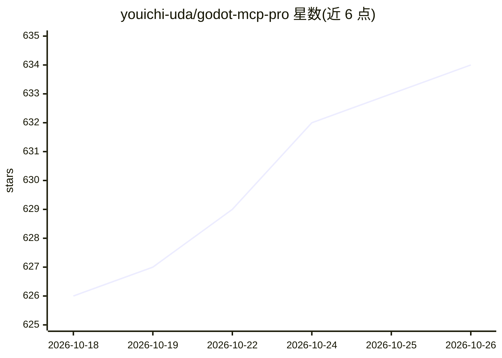

# youichi-uda/godot-mcp-pro

⭐ 634 · GDScript · NOASSERTION · 推送 2026-09-24 · [GitHub](https://github.com/youichi-uda/godot-mcp-pro) · [官网](https://godot-mcp.abyo.net/) · 个人维护

**连接 AI 助手与 Godot 编辑器的 MCP 服务器（187 工具）**

面向 Godot 4 游戏开发者的 MCP (Model Context Protocol) 服务器：通过 Node.js 服务器与 WebSocket 将 Claude 等 AI 助手接入 Godot 编辑器，提供 187 个工具，覆盖场景/节点/脚本编辑、编辑器控制、输入模拟、运行时检查、动画、TileMap、UI 主题、性能监控、批处理重构与着色器等。支持四种工具量模式（Full/3D/Lite/Minimal）以适配不同客户端的工具数限制，并提供 CLI 模式。注意：公开仓库仅含免费 Godot 插件，MCP 服务器随付费包分发（一次性购买）。

## 筛选速览

| 维度 | 判定 | 备注 |
|---|---|---|
| AI 角色 | `ai-ecosystem` | LLM/agent 周边工具 |
| 许可风险 | `none` | NOASSERTION |
| 部署形态 | `library` | 以包/库形式分发 |
| 模型依赖 | — | README 未给出锁定关系 |
| 硬件要求 | — | 无带数字的原话,不猜 |
| 安装摩擦 | `low` | 无编译、无系统依赖或容器化 |
| 成熟度 | — | 结构信号不足 |

## 能力要点

- 187 个工具覆盖场景、脚本、输入模拟、运行时检查、动画、着色器等
- WebSocket 实时连接编辑器，可访问编辑器 API、UndoRedo 与场景树
- 四种模式适配不同客户端工具数限制（187/100/88/35 工具）
- 提供无 MCP 客户端可用的 CLI 模式

## 适用场景

- 用 Claude Code 等 AI 助手直接操作 Godot 编辑器进行开发
- AI 驱动的场景搭建、脚本编写与输入模拟测试
- 运行时属性监控、截图对比与性能分析

## 场景标签

`编码 Agent` · 领域:编码与开发

## 证据(README 行号)

> L3: Premium MCP (Model Context Protocol) server for AI-powered Godot game development. Connects AI assistants like Claud
> L8: AI Assistant ←—stdio/MCP—→ Node.js Server ←—WebSocket:6505—→ Godot Editor Plugin

## 星数曲线

2026-10-18 626 → 2026-10-26 634（+8）

---
*卡片 v1 · prompt 1.4 · 生成 2026-10-21 · 置信度 high · 依据 README sha `792e564683bf` · [字段定义](../../DATASET.md)*
