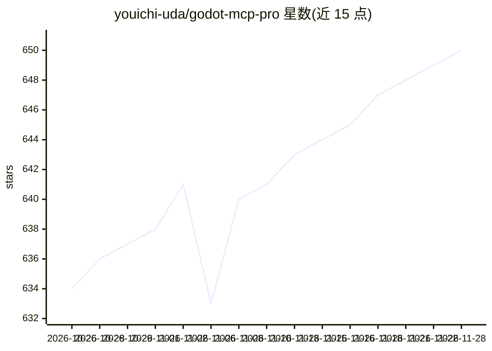

# youichi-uda/godot-mcp-pro

⭐ 650 · GDScript · NOASSERTION · 推送 2026-11-26 · [GitHub](https://github.com/youichi-uda/godot-mcp-pro) · [官网](https://godot-mcp.abyo.net/) · 个人维护

**让 AI 助手直接操作 Godot 4 编辑器的 MCP 服务器**

由 Godot 编辑器插件与 Node.js MCP 服务器组成：AI 助手经 stdio/MCP 连接服务器，服务器经 WebSocket（6505 端口）连接 Godot 编辑器插件，提供项目、场景、节点、脚本、动画、TileMap、主题 UI、输入模拟与运行时分析等 190 个工具，按客户端工具上限提供 Full/3D/Lite/Minimal 四种模式；不支持 MCP 的客户端可改用 CLI。注意：本公共仓库仅含免费 Godot 插件，MCP 服务器源码随付费包（一次性购买）分发。

## 筛选速览

| 维度 | 判定 | 备注 |
|---|---|---|
| AI 角色 | `ai-ecosystem` | LLM/agent 周边工具 |
| 许可风险 | `none` | NOASSERTION |
| 部署形态 | `library` | 以包/库形式分发 |
| 模型依赖 | — | README 未给出锁定关系 |
| 硬件要求 | — | 无带数字的原话,不猜 |
| 安装摩擦 | `low` | 无编译、无系统依赖或容器化 |
| 成熟度 | — | 结构信号不足 |

## 能力要点

- 190 个工具覆盖场景/节点/脚本/动画/TileMap/主题/输入模拟/运行时分析
- WebSocket 实时连接编辑器 API 与 UndoRedo 系统
- 四种工具模式适配不同客户端的工具数量上限
- 无 MCP 支持的客户端可用 CLI 模式渐进发现能力

## 适用场景

- 用自然语言让 Claude Code 直接在 Godot 编辑器中搭建游戏
- 让 AI 通过截图对比与运行时检查自行测试并修复 bug
- 在工具数量受限的客户端上以 Lite/Minimal 模式使用

## 场景标签

`编码 Agent` · 领域:编码与开发

## 证据(README 行号)

> L3: Premium MCP (Model Context Protocol) server for AI-powered Godot game development. Connects AI assistants like Claud
> L17: AI Assistant ←—stdio/MCP—→ Node.js Server ←—WebSocket:6505—→ Godot Editor Plugin
> L26: > ⚠️ **This public repo only contains the free Godot addon/plugin.** The MCP server (Node.js, required to connect A

## 星数曲线

2026-10-26 634 → 2026-11-28 650（+16）

---
*卡片 v1 · prompt 1.4 · 生成 2026-11-27 · 置信度 high · 依据 README sha `760dc85d9e0a` · [字段定义](../../DATASET.md)*
