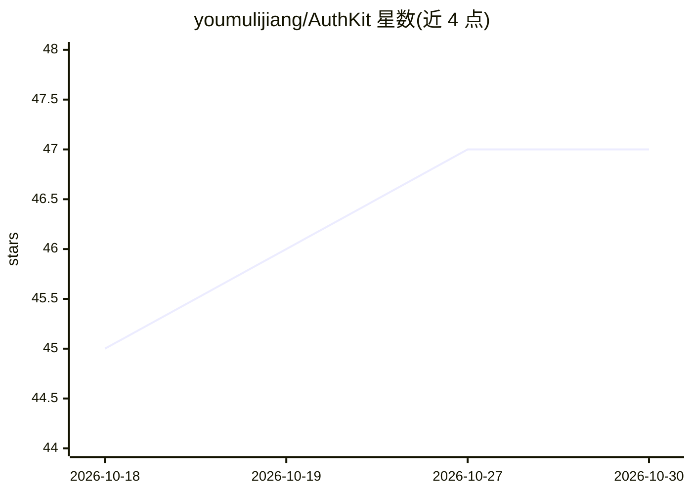

# youmulijiang/AuthKit

⭐ 47 · Java · 推送 2026-10-05 · [GitHub](https://github.com/youmulijiang/AuthKit) · 个人维护 · 中文 README

**Burp Suite 越权漏洞辅助检测插件，支持 AI 分析**

基于 Montoya API 的 Burp Suite Java 扩展，用于辅助发现未授权访问、水平/垂直越权及 BOLA/IDOR 风险：以 Original/Unauthorized/多用户身份重放请求，对响应做归一化评分（Rank）与差异对比，并提供 403 Bypass、IDOR、JWT 专项扫描、JWT 解码/签名校验/弱密钥测试、CSV/HTML 导出等功能。AI 为可选功能，配置模型服务后可进行对话分析、按需读取数据包与批准后发包验证。需 Burp Suite 与 Java 17+，从 Releases 下载 JAR 加载，或用 Maven 构建。

## 筛选速览

| 维度 | 判定 | 备注 |
|---|---|---|
| AI 角色 | `ai-enhanced` | 去掉 AI 部分产品仍成立 |
| 许可风险 | `none` | — |
| 部署形态 | `None` |  |
| 模型依赖 | — | README 未给出锁定关系 |
| 硬件要求 | — | 无带数字的原话,不猜 |
| 安装摩擦 | `medium` | 含编译或系统依赖之一 |
| 成熟度 | — | 结构信号不足 |

## 能力要点

- 多身份重放请求并做响应归一化评分与差异对比
- 403 Bypass、IDOR、JWT 专项扫描与 JWT 工具集
- 可选 AI 辅助分析（对话、数据包读取、批准后发包验证）
- 中英文切换、CSV/HTML 导出与右键送测

## 适用场景

- 渗透测试中对接口做未授权与水平/垂直越权检测
- Bug Bounty 中批量比对多身份响应差异定位 IDOR
- JWT 解码、签名校验与弱密钥测试

## 场景标签

`网络安全` · 领域:学习与行业

## 证据(README 行号)

> L3: AuthKit 通过多身份重放与多维度响应对比，辅助发现**未授权访问、水平越权、垂直越权及 BOLA / IDOR 风险**，减少重复发包和手工比对。
> L27: AI 为可选功能，在 `Configuration → AI Analysis` 中配置模型服务即可使用。详细操作与常见问题见使用指南。

## 星数曲线

2026-10-18 45 → 2026-10-30 47（+2）

---
*卡片 v1 · prompt 1.4 · 生成 2026-10-25 · 置信度 high · 依据 README sha `9120316e0688` · [字段定义](../../DATASET.md)*
