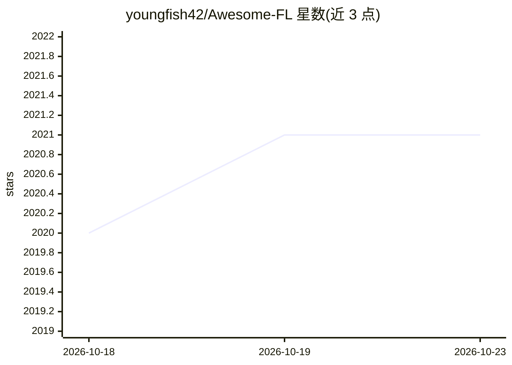

# youngfish42/Awesome-FL

⭐ 2,021 · Python · CC-BY-SA-4.0 · 推送 2026-10-18 · [GitHub](https://github.com/youngfish42/Awesome-FL) · [官网](https://youngfish42.github.io/Awesome-FL) · 个人维护 · 中文 README

**联邦学习学术资源清单：论文、框架、数据集与教程汇总**

面向联邦学习研究者维护的学术资源聚合清单，按会议/期刊类别（AI、ML、数据挖掘、安全、CV、NLP、IR、数据库、网络、系统等）收录 2020 年以来的顶会顶刊 FL 论文，条目标注 PUB/PDF/CODE 等材料链接，并以图标标记开源代码（stars≥100）、引用量与顶会属性；另覆盖图数据/GNN、表格数据等子方向、关键会议与 workshop 信息，配套一个自动追踪论文更新的独立项目。作者 2024 年博士毕业后更新频率降为按月或按季，机构信息与开源代码维护已停止，正邀请社区贡献者参与更新。

## 筛选速览

| 维度 | 判定 | 备注 |
|---|---|---|
| AI 角色 | `ai-knowledge` | 知识聚合/清单类 |
| 许可风险 | `viral` | CC-BY-SA-4.0 |
| 部署形态 | `None` |  |
| 模型依赖 | — | README 未给出锁定关系 |
| 硬件要求 | — | 无带数字的原话,不猜 |
| 安装摩擦 | `low` | 无编译、无系统依赖或容器化 |
| 成熟度 | — | 结构信号不足 |

## 能力要点

- 按十余个会议/期刊类别组织 FL 论文条目，含 PUB/PDF/CODE 链接
- 以图标标记代码可用（stars≥100）、引用≥50 与顶会发表
- 覆盖图数据/GNN、表格数据等细分方向与 dblp 检索入口
- 配套独立的论文更新自动追踪项目

## 适用场景

- 按会议和年份查找联邦学习顶会顶刊论文及代码
- 跟踪联邦学习在医疗、图学习等领域的应用文献
- 查找联邦学习相关的数据集、教程与 workshop 信息

## 场景标签

 · 领域:机器学习/联邦学习文献聚合

## 证据(README 行号)

> L1: # Federated Learning Resources
> L7: - Papers

## 星数曲线

2026-10-18 2,020 → 2026-10-23 2,021（+1）

---
*卡片 v1 · prompt 1.4 · 生成 2026-10-21 · 置信度 high · 依据 README sha `a5577d59e430` · [字段定义](../../DATASET.md)*
