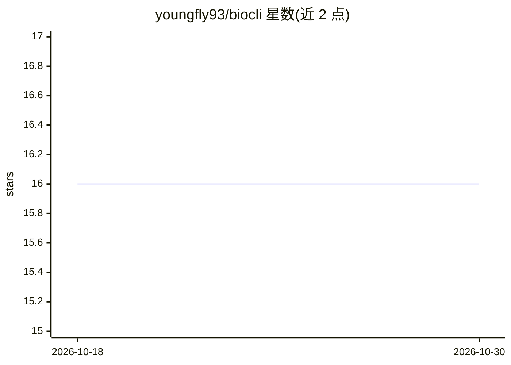

# youngfly93/biocli

⭐ 16 · TypeScript · MIT · 推送 2026-08-26 · [GitHub](https://github.com/youngfly93/biocli) · [官网](https://www.npmjs.com/package/@yangfei_93sky/biocli) · 个人维护

**面向 AI agent 的生物学工作流 CLI：批量基因扫描与靶点发现**

Node.js 命令行工具，定位为 agent 驱动的生物学工作流执行层：跨 NCBI、UniProt、KEGG、STRING、cBioPortal、Open Targets 等 11 个数据库后端（65 个命令）做批量基因扫描、肿瘤队列简报与靶点发现。关键机制：结构化 BiocliResult 信封输出（data/ids/sources/warnings）、--input-file 批量运行、--resume 断点续跑、results.jsonl/manifest.json/methods.md 稳定产物、24 小时本地缓存。限制：非序列分析框架（无 BLAST/AlphaFold）、不做统计建模、包装在线 REST API 而非本地数据库。面向研究生、博士后与使用 Claude Code/Codex CLI 等 agent 的研究工程师。

## 筛选速览

| 维度 | 判定 | 备注 |
|---|---|---|
| AI 角色 | `ai-ecosystem` | LLM/agent 周边工具 |
| 许可风险 | `permissive` | MIT |
| 部署形态 | `library` | 以包/库形式分发 |
| 模型依赖 | — | README 未给出锁定关系 |
| 硬件要求 | — | 无带数字的原话,不猜 |
| 安装摩擦 | `low` | 无编译、无系统依赖或容器化 |
| 成熟度 | — | 结构信号不足 |

## 能力要点

- 跨 11 个公共数据库后端的批量基因扫描与靶点发现（65 个命令）
- 结构化 JSON 输出与 data.agentSummary 摘要优先模式
- --resume 断点续跑与 results.jsonl/manifest.json/methods.md 稳定运行产物
- 无需 API key 即可运行（可选 NCBI key 提升限速）

## 适用场景

- 用基因列表批量生成可复现的靶点筛选运行目录
- 让 Claude Code/Codex CLI 等 agent 可靠获取结构化生物学数据
- 生成 TP53 等基因的跨数据库汇总简报

## 场景标签

`工作流自动化` `科研工具` · 领域:效率与自动化

## 证据(README 行号)

> L11: **biocli is the execution layer for agent-driven biology workflows.**
> L238: Designed for **AI agents** (Claude Code, Codex CLI, etc.) — structured JSON output, per-command schema, self-descr
> L246: - You use Claude Code, Codex CLI, Cursor, or any AI coding agent that needs **reliable, structured, self-describin

## 星数曲线

2026-10-18 16 → 2026-10-30 16（+0）

---
*卡片 v1 · prompt 1.4 · 生成 2026-10-30 · 置信度 high · 依据 README sha `4e2388a35c0e` · [字段定义](../../DATASET.md)*
