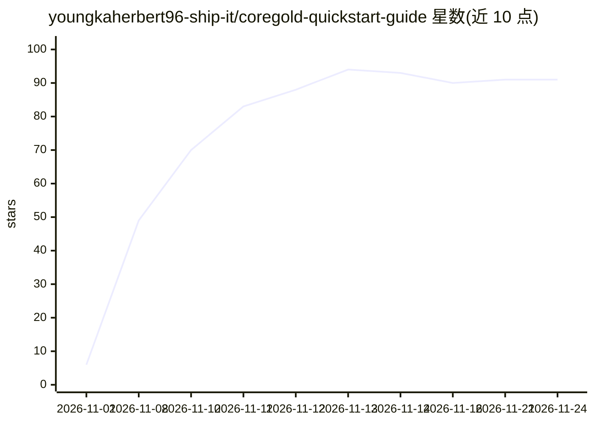

# youngkaherbert96-ship-it/coregold-quickstart-guide

⭐ 94 · 推送 2026-10-30 · [GitHub](https://github.com/youngkaherbert96-ship-it/coregold-quickstart-guide) · [官网](https://app.coregold.io/signup?invite_code=ADvlj9b) · 个人维护 · 中文 README

**CoreGold 虚拟卡开卡订阅操作指南，用于海外平台支付**

一份面向消费者的图文操作指南，内容为注册 CoreGold 平台、充值 USDT、开通海外 Visa/Mastercard 虚拟卡并绑定到 ChatGPT Plus、Claude Pro、Cursor 等订阅服务的分步流程（共三段、宣称各 1 分钟）。机制上强调 USDT 按实时汇率折算美元、单卡限额、注销后余额退回母账户。README 不含代码、无安装运行内容，仅含指向官方控制台的注册入口；页面末尾附有一串十六进制标识。AI 相关内容仅为订阅对象的列举。

## 筛选速览

| 维度 | 判定 | 备注 |
|---|---|---|
| AI 角色 | `ai-knowledge` | 知识聚合/清单类 |
| 许可风险 | `none` | — |
| 部署形态 | `None` |  |
| 模型依赖 | — | README 未给出锁定关系 |
| 硬件要求 | — | 无带数字的原话,不猜 |
| 安装摩擦 | `low` | 无编译、无系统依赖或容器化 |
| 成熟度 | — | 结构信号不足 |

## 能力要点

- 分步演示 USDT 充值、选卡段、设限额、绑定扣费的完整流程
- 卡类型为商业 Visa/Mastercard 虚拟卡，配套生成海外账单地址
- 说明 $2~3 验资缓冲与卡片注销资金退回机制

## 适用场景

- 按指南开通虚拟卡以订阅海外 AI/SaaS 服务
- 了解 USDT 充值折算与单卡限额的设置方式

## 场景标签

 · 领域:支付/虚拟卡服务

## 证据(README 行号)

> L2: ⚡ 3 分钟极速开卡订阅指南：彻底搞定海外平台扣款被拒
> L31: 2. 打开目标服务（ChatGPT Plus、Claude Pro、Cursor、Midjourney、AWS 等）的结账页面。

## 星数曲线

2026-11-01 6 → 2026-11-24 91（+85）

---
*卡片 v1 · prompt 1.4 · 生成 2026-11-17 · 置信度 mid · 依据 README sha `7e94e396813a` · [字段定义](../../DATASET.md)*
