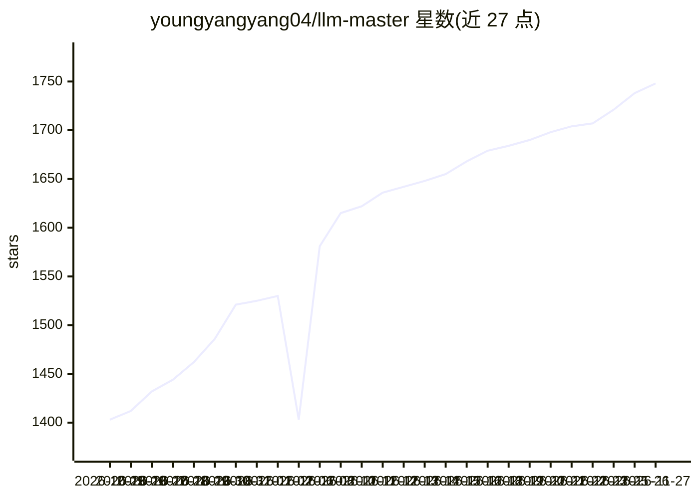

# youngyangyang04/llm-master

⭐ 1,748 · MIT · 推送 2026-11-11 · [GitHub](https://github.com/youngyangyang04/llm-master) · [官网](https://notes.kamacoder.com/llm/) · 组织维护 · 中文 README

**程序员的大模型全栈中文学习路线与教程合集**

来自卡码笔记的大模型学习仓库，按基础认知→应用开发→RAG→Agent→微调与部署→Transformer→面试的路线组织 180+ 篇教程与面经，覆盖 Prompt、Function Calling、RAG 检索链路、Multi-Agent、SFT/LoRA、vLLM 部署等主题。每个阶段配有可交付项目和完成标准，并附四个简历项目及面试题库。仓库声明以应用工程为主，不以算法研究和大规模预训练为主，另提供付费训练营报名入口。

## 筛选速览

| 维度 | 判定 | 备注 |
|---|---|---|
| AI 角色 | `ai-knowledge` | 知识聚合/清单类 |
| 许可风险 | `permissive` | MIT |
| 部署形态 | `None` |  |
| 模型依赖 | — | README 未给出锁定关系 |
| 硬件要求 | — | 无带数字的原话,不猜 |
| 安装摩擦 | `low` | 无编译、无系统依赖或容器化 |
| 成熟度 | — | 结构信号不足 |

## 能力要点

- 六阶段学习路线：模型调用→RAG→Agent→生产工程→原理与面试
- 每阶段配可交付项目与完成标准，含四个简历项目
- 面试专题覆盖 RAG、Agent、微调、Transformer 高频题与大厂面经
- 公开正文 187 篇，持续更新（最近同步 2026-11-11）

## 适用场景

- 有开发基础想系统转入大模型应用开发的程序员
- 搭建 RAG 或 Agent 系统时按专题查缺补漏
- 准备大模型岗位面试，组织项目表达

## 场景标签

`教程课程` · 领域:学习与行业

## 证据(README 行号)

> L19: `LLM Master` 不是零散文章的合集，而是一套从**基础认知 → 应用开发 → RAG → Agent → 微调与部署 → Transformer → 项目与面试**逐级展开的完整知识体系。它关心的不只是“这个概念是什么”
> L144: 4. **寻找某篇文章**：打开全部资料索引，浏览 180+ 篇教程与面经。
> L154: 它不以纯算法研究和大规模预训练为主。如果你的目标是研究新型模型结构、训练基础模型或深入数学证明，建议将本仓库作为应用工程补充，而不是唯一资料。

## 星数曲线

2026-10-25 1,403 → 2026-11-27 1,748（+345）

---
*卡片 v1 · prompt 1.4 · 生成 2026-11-23 · 置信度 high · 依据 README sha `84fa43831d5e` · [字段定义](../../DATASET.md)*
