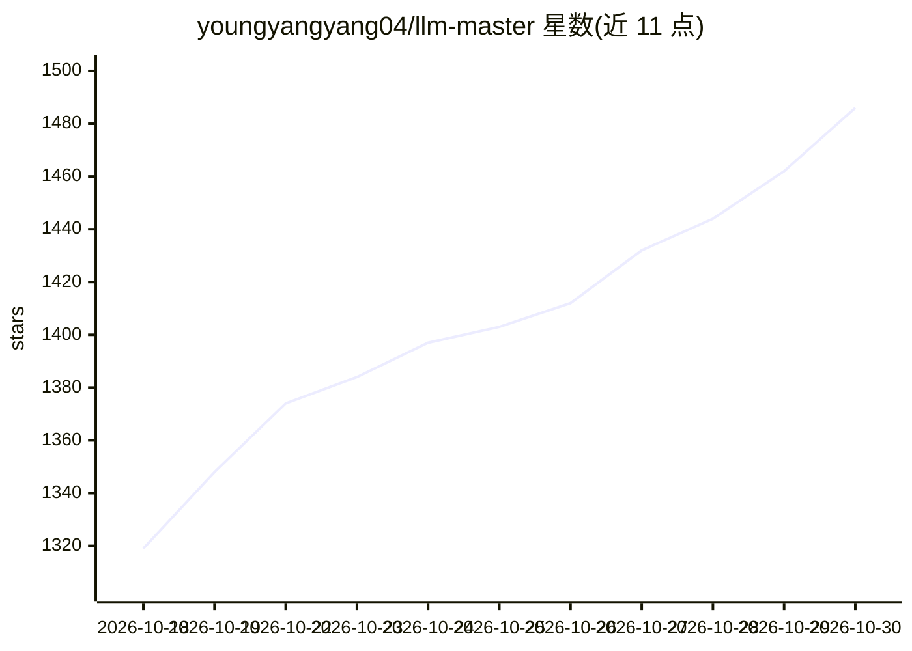

# youngyangyang04/llm-master

⭐ 1,486 · MIT · 推送 2026-10-24 · [GitHub](https://github.com/youngyangyang04/llm-master) · [官网](https://notes.kamacoder.com/llm/) · 组织维护 · 中文 README

**程序员的大模型全栈学习路线与中文教程仓库**

面向有 Java、C++、Go、Python 等开发基础的程序员，提供从模型调用、RAG、Agent、微调部署到 Transformer 原理与大厂面试的分级学习路线，资料来自卡码笔记大模型专栏（150+ 篇教程与面经）。内容按知识依赖组织为 0-5 六个阶段，每阶段设项目交付标准，另整理 RAG、Agent、Transformer、AI 编程等专题与面试题库。仓库声明以应用工程为主，不覆盖纯算法研究与大规模预训练。

## 筛选速览

| 维度 | 判定 | 备注 |
|---|---|---|
| AI 角色 | `ai-knowledge` | 知识聚合/清单类 |
| 许可风险 | `permissive` | MIT |
| 部署形态 | `None` |  |
| 模型依赖 | — | README 未给出锁定关系 |
| 硬件要求 | — | 无带数字的原话,不猜 |
| 安装摩擦 | `low` | 无编译、无系统依赖或容器化 |
| 成熟度 | — | 结构信号不足 |

## 能力要点

- 0-5 六阶段学习路线，覆盖调用→RAG→Agent→生产工程→原理与面试
- 每个阶段配有项目与完成标志，含四个可写进简历的项目及交付标准
- 150+ 篇中文教程与面经，含大厂面经与高频面试题整理
- 覆盖 RAG、Agent、微调、部署、Transformer、AI 编程等专题索引

## 适用场景

- 有开发基础的我系统转入大模型应用开发
- 搭建 RAG 或 Agent 时按专题查缺补漏
- 准备大模型岗位面试并组织项目表达

## 场景标签

`教程课程` · 领域:学习与行业

## 证据(README 行号)

> L19: `LLM Master` 不是零散文章的合集，而是一套从**基础认知 → 应用开发 → RAG → Agent → 微调与部署 → Transformer → 项目与面试**逐级展开的完整知识体系。它关心的不只是“这个概念是什么”
> L21: 如果你有 Java、C++、Go、Python 或前端开发基础，希望进入大模型应用开发、Agent 工程或 AI 后端，这个仓库就是为你准备的。

## 星数曲线

2026-10-18 1,319 → 2026-10-30 1,486（+167）

---
*卡片 v1 · prompt 1.4 · 生成 2026-10-21 · 置信度 high · 依据 README sha `a0e31a7647c7` · [字段定义](../../DATASET.md)*
