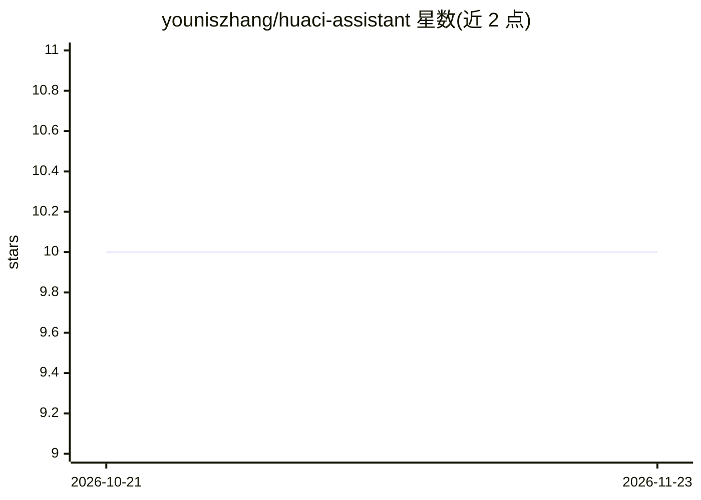

# youniszhang/huaci-assistant

⭐ 10 · JavaScript · MIT · 推送 2026-10-14 · [GitHub](https://github.com/youniszhang/huaci-assistant) · 个人维护 · 中文 README

**给终端用户的系统级划词助手：选中文字即获 AI 解释并录入 Obsidian**

基于 Electron 的桌面工具，覆盖 macOS 与 Windows：任意应用中选中文字后按快捷键唤起工具条，调用配置的 LLM 供应商流式生成解释/翻译/总结/意图分析/拟回复，结果写入 Obsidian 收集目录并落盘本机生成记录。划词捕获由平台原生层实现（macOS Swift + Accessibility API/CGEventTap，Windows C#/.NET + UI Automation + 鼠标钩子），框选分析走本地 OCR（macOS Vision / Windows.Media.Ocr），截图不上传。供应商配置存本机 providers.json，支持 OpenAI 兼容 API 与免 Key 的 DeepSeek 网页版通道。Windows 原生层自述尚未在真机完整验证。

## 筛选速览

| 维度 | 判定 | 备注 |
|---|---|---|
| AI 角色 | `ai-native` | 本体是模型或模型工具 |
| 许可风险 | `permissive` | MIT |
| 部署形态 | `desktop` | 安装包/桌面程序 |
| 模型依赖 | locked-api |  |
| 硬件要求 | — | 无带数字的原话,不猜 |
| 安装摩擦 | `medium` | 含编译或系统依赖之一 |
| 成熟度 | — | 结构信号不足 |

## 能力要点

- 五种动作（解释/翻译/总结/意图分析/拟回复）+ 多轮追问 + 流式输出
- 框选屏幕区域走本地 OCR 后分析，截图不上传
- 一键录入 Obsidian，按日期文件追加并用 djb2 哈希覆盖同条目
- DeepSeek 网页版免 API Key，用专用浏览器 profile 与独立端口

## 适用场景

- 在浏览器/PDF/微信里选中术语后让 AI 即时解释
- 框选聊天记录做意图分析并生成回复草稿
- 把每天的划词解释自动归档到 Obsidian 笔记库

## 场景标签

`AI 助手` `知识库管理` `OCR` · 领域:对话与助手

## 证据(README 行号)

> L7: > 系统级「豆包式」划词助手：在**任何应用**里选中文字 → 按快捷键唤起工具条 → AI 流式解释 → 一键录入 Obsidian 笔记。
> L66: - **多供应商**：三方 OpenAI 兼容 API（aitry / 智谱 / DeepSeek 官方…）+ DeepSeek 网页版（**免 API Key**，用独立浏览器登录态）
> L67: - **跨平台**：macOS（Swift 原生层）与 Windows（C#/.NET 原生层）功能对等 —— 划词捕获、框选 OCR、悬浮工具条全都有

## 星数曲线

2026-10-21 10 → 2026-11-23 10（+0）

---
*卡片 v1 · prompt 1.4 · 生成 2026-11-19 · 置信度 high · 依据 README sha `497afb5e1a47` · [字段定义](../../DATASET.md)*
