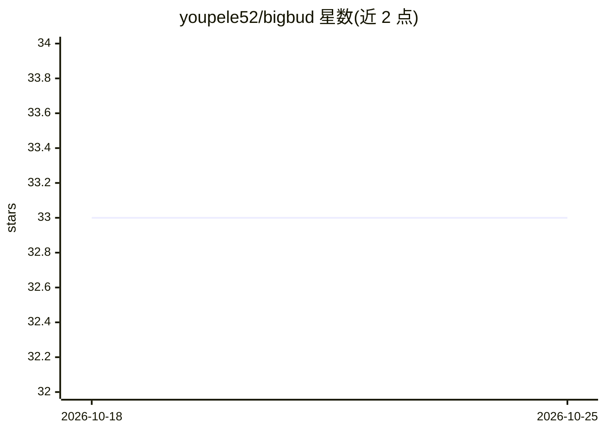

# youpele52/bigbud

⭐ 33 · TypeScript · MIT · 推送 2026-10-25 · [GitHub](https://github.com/youpele52/bigbud) · [官网](https://bigbud.app) · 个人维护

**自带多 AI 编码代理的统一工作台：研究/写作/编码/文件一站式**

基于 Electron 的桌面应用（另有 Web 模式），把研究、写作、编码、文件与 git 工作流集中在一处。作为多代理客户端，可在 Codex、Claude、Copilot、OpenCode、Pi、Cursor 等提供方间切换，各自独立鉴权与开关。支持 SSH 远程项目（内置 Rust 托管代理）、内嵌浏览器、Computer Use 桌面/浏览器自动化（macOS，经 cua-driver MCP）、基于 OpenAI Realtime API 的实时语音转文字（自带 API key）。开发用 bun，桌面端提供 macOS/Linux/Windows 安装包，暂不接受社区贡献。

## 筛选速览

| 维度 | 判定 | 备注 |
|---|---|---|
| AI 角色 | `ai-ecosystem` | LLM/agent 周边工具 |
| 许可风险 | `permissive` | MIT |
| 部署形态 | `library` | 以包/库形式分发 |
| 模型依赖 | locked-api |  |
| 硬件要求 | — | 无带数字的原话,不猜 |
| 安装摩擦 | `low` | 无编译、无系统依赖或容器化 |
| 成熟度 | — | 结构信号不足 |

## 能力要点

- 多提供方切换：Codex/Claude/Copilot/OpenCode/Pi/Cursor，实时状态检测
- SSH 远程项目 + Rust 托管远程代理，支持重连与会话保持
- Computer Use：应用内浏览器自动化与 macOS 桌面自动化，权限门控与安全护栏
- OpenAI Realtime API 实时语音转文字（BYOK，音频不经服务器）

## 适用场景

- 在同一应用里管理并切换多个 AI 编码代理做研究、写作和编码
- 通过 SSH 直接操作远程项目而无需迁移本地环境
- 让代理在浏览器或 macOS 桌面上代为执行操作并人工审批

## 场景标签

`浏览器自动化` `GUI 自动化` `编码 Agent` `语音识别` · 领域:效率与自动化

## 证据(README 行号)

> L15: - **Multi-provider support** — Switch between Codex, Claude, Copilot, OpenCode, Pi, Cursor, and more
> L71: bigbud supports multiple AI coding agents. Configure at least one in **Settings → Providers**:
> L75: |**Claude**|Install Claude Code: `npm i -g @anthropic-ai/claude-code`, then `claude auth login`|

## 星数曲线

2026-10-18 33 → 2026-10-25 33（+0）

---
*卡片 v1 · prompt 1.4 · 生成 2026-10-25 · 置信度 mid · 依据 README sha `13df956d8c3b` · [字段定义](../../DATASET.md)*
