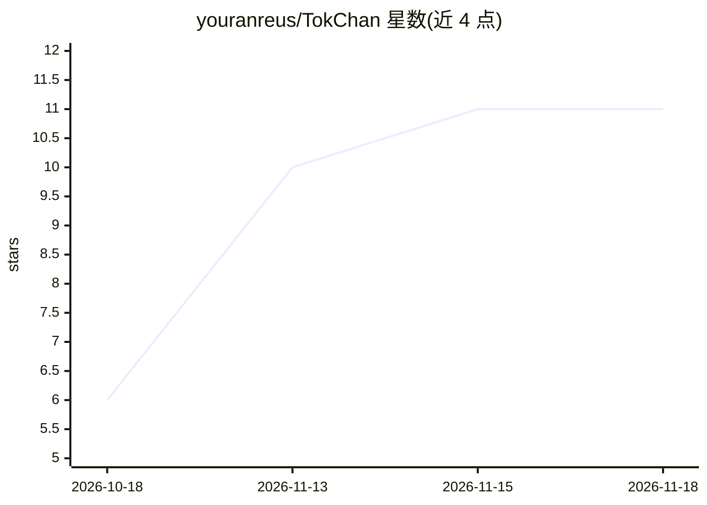

# youranreus/TokChan

⭐ 11 · Swift · 推送 2026-10-15 · [GitHub](https://github.com/youranreus/TokChan) · 个人维护 · 中文 README

**在 macOS 菜单栏查看 Tokscale AI 编程用量的应用**

TokChan 是原生 macOS 菜单栏应用，读取 Tokscale 统计的本地或在线 AI 编程工具用量，展示 Tokens、成本、客户端与模型明细，在线模式额外显示排名和活跃天数。它独立于 Tokscale，不自己扫描数据，而是通过 `npx tokscale` 调用上游 CLI，并在图形界面中管理自动提交配置和自定义模型价格。支持 DMG 安装与 Xcode 源码构建，要求 macOS 13+ 且系统装有 Node.js。

## 筛选速览

| 维度 | 判定 | 备注 |
|---|---|---|
| AI 角色 | `ai-ecosystem` | LLM/agent 周边工具 |
| 许可风险 | `none` | — |
| 部署形态 | `library` | 以包/库形式分发 |
| 模型依赖 | — | README 未给出锁定关系 |
| 硬件要求 | — | 无带数字的原话,不猜 |
| 安装摩擦 | `medium` | 含编译或系统依赖之一 |
| 成熟度 | — | 结构信号不足 |

## 能力要点

- 菜单栏展示 Tokens、成本及输入/输出/缓存/推理五类拆分
- 本地与在线模式切换，可管理 Tokscale 自动提交
- 为缺失模型补充自定义价格并检查缺口
- 支持 DMG 安装、Sparkle 应用内更新与源码构建

## 适用场景

- 不用开终端就能查看 AI 编程工具的用量和成本
- 在图形界面中开启或配置 Tokscale 自动提交
- 查看其他人的公开用量统计

## 场景标签

`LLM 可观测性` · 领域:评测与运维

## 证据(README 行号)

> L17: TokChan 是一款原生 macOS 菜单栏应用，用来查看 Tokscale 的本地或在线 AI 编程工具用量。打开菜单栏面板，就能看到 Tokens、成本，以及客户端和模型明细；在线模式还会显示排名和活跃天数。提交数据、管理自
> L50: TokChan 会通过 `npx --yes tokscale@<版本>` 调用 Tokscale CLI。本地模式读取 `graph --no-spinner` 并按 Tokscale 配置的统计时区派生四个范围；在线模式从 T

## 星数曲线

2026-10-18 6 → 2026-11-18 11（+5）

---
*卡片 v1 · prompt 1.4 · 生成 2026-11-18 · 置信度 mid · 依据 README sha `5c1e4ec21f3f` · [字段定义](../../DATASET.md)*
