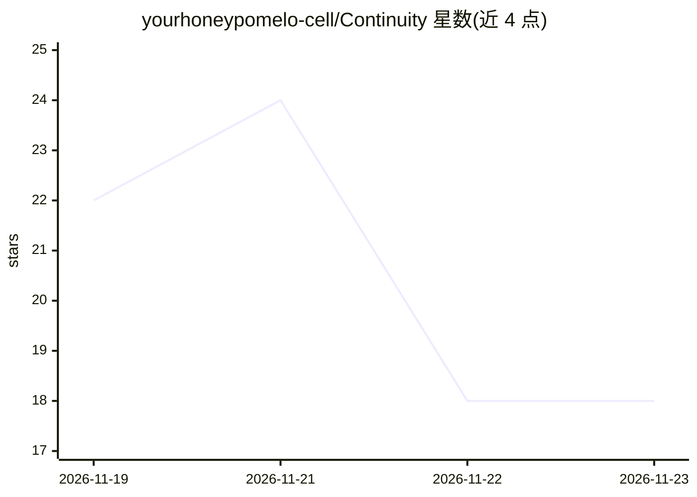

# yourhoneypomelo-cell/Continuity

⭐ 18 · Python · MIT · 推送 2026-11-18 · [GitHub](https://github.com/yourhoneypomelo-cell/Continuity) · 个人维护 · 中文 README

**给 AI 编码 agent 提供基于 Markdown 文件的跨会话记忆**

Continuity 在项目 docs/state/ 下用纯 Markdown 文件保存需求、决策、任务与验收证据，agent 在新会话开始时重读这些文件，从而在窗口切换、上下文压缩、更换工具后恢复进度。核心是根契约 AGENTS.md 加各主机适配器，配合仅依赖 Python 标准库的 ws.py CLI：校验写入、分配 ID、运行验收命令并存储证据，任务只有验收通过才标记完成。支持多会话通过文件路径声明任务避免冲突，写入内容默认对凭证脱敏。

## 筛选速览

| 维度 | 判定 | 备注 |
|---|---|---|
| AI 角色 | `ai-ecosystem` | LLM/agent 周边工具 |
| 许可风险 | `permissive` | MIT |
| 部署形态 | `None` |  |
| 模型依赖 | — | README 未给出锁定关系 |
| 硬件要求 | — | 无带数字的原话,不猜 |
| 安装摩擦 | `low` | 无编译、无系统依赖或容器化 |
| 成熟度 | — | 结构信号不足 |

## 能力要点

- 七份 Markdown 状态文件（交接卡、需求、任务等）作为跨会话事实来源
- ws verify 运行验收命令并存储证据，未通过不标记完成
- 任务按文件路径与资源名声明，支持多个 agent 窗口并行工作
- 适配 Claude Code、Codex、Cursor、Gemini、Kiro、Kimi Code 等 10 个主机

## 适用场景

- 长项目跨多个会话，让 agent 恢复目标、停点与下一步
- 上下文压缩后从磁盘恢复需求与禁止事项
- 在 Claude Code 与 Cursor 等工具之间切换继续同一项目
- 要求每个任务附带可运行的验收命令作为完成证明

## 场景标签

`Agent 记忆` · 领域:Agent 开发

## 证据(README 行号)

> L7: Continuity gives AI coding agents a shared handoff. A new session can read what you asked for,
> L51: Every agent tool loads one root contract, `AGENTS.md`, through a thin adapter. The agent runs
> L124: - **`ws.py`** is the CLI tool that validates writes, assigns IDs, runs acceptance tests, and seals

## 星数曲线

2026-11-19 22 → 2026-11-23 18（-4）

---
*卡片 v1 · prompt 1.4 · 生成 2026-11-19 · 置信度 high · 依据 README sha `1f15734bc1ce` · [字段定义](../../DATASET.md)*
