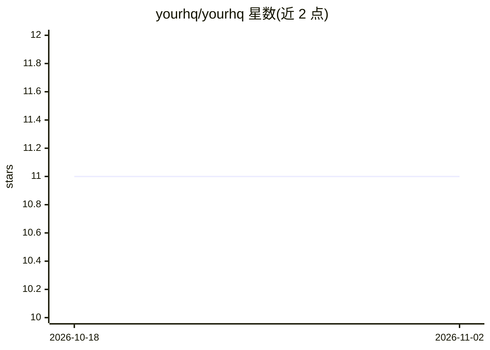

# yourhq/yourhq

⭐ 11 · TypeScript · Apache-2.0 · 推送 2026-09-13 · [GitHub](https://github.com/yourhq/yourhq) · [官网](https://yourhq.ai) · 组织维护

**自托管 AI agent 运营平台：一个 UI 管理长期运行的多 agent**

自托管的 agent 运营仪表盘：在用户自己的 Docker 主机与 Supabase 上运行长期存活的 AI agent，可浏览网页、收发 Telegram/Discord/Slack 消息、操作 CRM/任务/知识库等业务工作区，agent 间可委派协作并拥有跨会话持久记忆。每个网关主机运行六个服务（OpenClaw agent 运行时、Chrome、XFCE、noVNC 等），模型通过 OpenClaw 接入 OpenAI/Anthropic/Gemini/Ollama 等。一行脚本安装，附带 16 个 agent 模板；当前为 v0.1 活跃开发中，另提供托管版 app.yourhq.ai。

## 筛选速览

| 维度 | 判定 | 备注 |
|---|---|---|
| AI 角色 | `ai-ecosystem` | LLM/agent 周边工具 |
| 许可风险 | `permissive` | Apache-2.0 |
| 部署形态 | `self-host` | docker 或自建部署 |
| 模型依赖 | — | README 未给出锁定关系 |
| 硬件要求 | — | 无带数字的原话,不猜 |
| 安装摩擦 | `low` | 无编译、无系统依赖或容器化 |
| 成熟度 | `idea` | |

## 能力要点

- 自托管：仅以用户自己的 Supabase 为后端，无云端依赖
- 网关主机运行 OpenClaw agent 运行时 + Chrome + 桌面环境，六服务架构
- agent 具持久记忆、月度用量预算、相互委派能力
- 内置 16 个可定制 agent 模板与运营工作区（CRM/任务/知识库/例程）

## 适用场景

- 在自有服务器上运行一队长期存活的 AI agent 处理外联、任务与消息
- 团队在一个 UI 里管理多个 agent 及其工作区
- 从笔记本到多云主机的多网关部署，不改架构逐步扩展

## 场景标签

`多智能体` `Agent 记忆` `浏览器自动化` · 领域:Agent 开发

## 证据(README 行号)

> L19: HQ is a self-hosted dashboard for running AI agents that do real work on your behalf: drafting outreach, managing c
> L90: - **Gateway** — OpenClaw agent runtime, Chrome, XFCE desktop, noVNC, and the files API
> L119: - **Model-agnostic** — any provider: OpenAI, Anthropic, Gemini, Ollama, and many others via OpenClaw

## 星数曲线

2026-10-18 11 → 2026-11-02 11（+0）

---
*卡片 v1 · prompt 1.4 · 生成 2026-11-01 · 置信度 high · 依据 README sha `83b6440dfe3f` · [字段定义](../../DATASET.md)*
