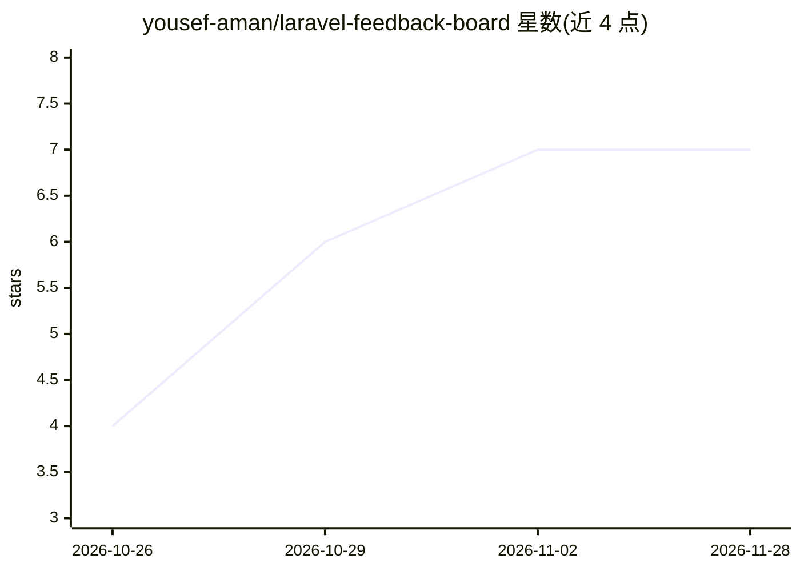

# yousef-aman/laravel-feedback-board

⭐ 7 · PHP · MIT · 推送 2026-10-20 · [GitHub](https://github.com/yousef-aman/laravel-feedback-board) · 个人维护

**Laravel 自托管应用内反馈组件：截图报告、AI 分诊与看板**

面向 Laravel 应用的自托管可嵌入反馈组件：登录用户在会话内提交 bug 报告与功能请求，可附粘贴的截图；数据存于用户自己的数据库与基础设施，无第三方脚本。核心机制包括：开发者注册解析器控制谁可报告/谁可管理、邮件与数据库通知渠道、可选的 webhook/Slack/GitHub Issues 目的地驱动，以及可选的 AI 分诊（仅发送报告标题与描述到所选模型提供商）和可代发修复 PR 的 AI runner。所有可选功能默认关闭。提供独立页面与 Filament 面板插件两种使用形态。

## 筛选速览

| 维度 | 判定 | 备注 |
|---|---|---|
| AI 角色 | `ai-enhanced` | 去掉 AI 部分产品仍成立 |
| 许可风险 | `permissive` | MIT |
| 部署形态 | `None` |  |
| 模型依赖 | — | README 未给出锁定关系 |
| 硬件要求 | — | 无带数字的原话,不猜 |
| 安装摩擦 | `low` | 无编译、无系统依赖或容器化 |
| 成熟度 | — | 结构信号不足 |

## 能力要点

- 自托管设计：报告存于自有数据库，由自有 runner 处理
- 截图报告支持选取、拖放与粘贴三种方式
- 可选 AI 分诊与 AI runner（可代为开 PR）
- Filament 面板插件与独立页面双形态，支持 RTL 与暗色主题

## 适用场景

- 为自己的 Laravel 产品收集带截图的应用内 bug 报告
- 开发团队用看板对反馈分诊、回复并跟踪解决状态
- 在数据不出自有基础设施的前提下启用 AI 分诊

## 场景标签

`工作流自动化` `编码 Agent` · 领域:效率与自动化

## 证据(README 行号)

> L11: A self-hosted, embeddable feedback widget for Laravel applications. Clients submit bug reports and feature requests
> L17: Feedback Board is self-hosted by design. Reports are captured inside the authenticated client's session (no third-p
> L24: - Filament 4 or 5 (optional). Without it, "My reports" and the developer board are pages of the package itself; see

## 星数曲线

2026-10-26 4 → 2026-11-28 7（+3）

---
*卡片 v1 · prompt 1.4 · 生成 2026-11-20 · 置信度 high · 依据 README sha `88e4969744c5` · [字段定义](../../DATASET.md)*
